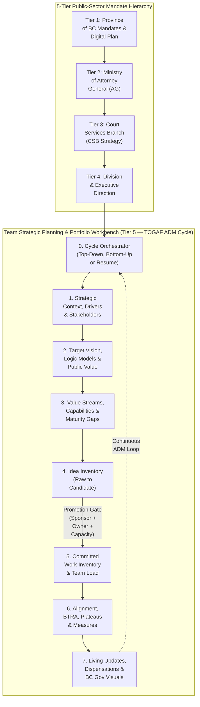

# Strategic Planning Workbench

An APM-native agentic workbench for **organizational, division, and public-sector branch strategic planning, capability-based planning, idea funnel management, portfolio alignment, living register updates, and visual/executive presentation rendering**—tailored for the **BC Government / Ministry of Attorney General / Court Services Branch (CSB)** multi-tier context.

## What This Workbench Is About

Conventional product management tools and AI plugins focus on downstream delivery: feature specs, user stories, sprint backlogs, and product launches. Conversely, enterprise architecture toolkits often jump straight into technical infrastructure or heavyweight compliance artifacts.

Government divisions, branches, and teams translating leadership direction into action face a different challenge:
1. **Multi-Tier Mandate Alignment**: A team's strategy must align upward through **Division**, **Branch (Court Services Branch)**, **Ministry (Ministry of Attorney General)**, and **Province-Wide (BC Government)** mandates and service plans.
2. **Bridging Vision to Capabilities before Solutions**: Moving from *"who are the players and what are our problems?"* to *"what must our organization be able to do (capabilities)?"* before jumping into projects or technology tools.
3. **Keeping Vision, Ideas, and Committed Work Separate**: Preventing brainstormed ideas or exploratory prototypes from being confused with funded, approved commitments.
4. **Living Registers & Executive Visuals**: Capturing, saving, and incrementally updating evolving priorities, new drivers, stakeholder concerns, and work progress over time—and rendering them on demand into **Mermaid roadmaps, Gantt charts, alignment diagrams, and leadership presentations**.

## Core Principles & Non-Negotiable Guardrails

1. **Five-Tier Organizational Line of Sight**
   - Explicitly traces team vision and strategic objectives (`OBJ-X`) upward through **Division**, **Branch (CSB)**, **Ministry (AG)**, and **Province-Wide (BC Gov)** goals while distinguishing `Confirmed` direction from `Interpreted` remarks.
2. **Three Distinct Layers & Inventories**
   - **Strategic Vision, Logic Models, Value Streams & Capabilities**: *Where are we trying to go, why does it matter, what causal results pathways connect inputs to public outcomes, and what must our organization be able to do?*
   - **Idea Inventory (`IDEA-X`)**: *What might we do?* Captures raw opportunities, experiments, and proposals across maturity states (`raw` → `explored` → `validated` → `candidate` → `deferred` / `rejected`) without forcing premature scoring.
   - **Committed Work Inventory (`WORK-X`)**: *What are we actually doing or committed to doing?* Tracks approved initiatives, time-boxed active experiments, and operational responsibilities with verified sponsorship and ownership.
3. **Evidence Over Invention & No Premature Solutioning**
   - Separates documented facts from unproven assumptions (`ASM-X`) and evidence gaps (`GAP-X`). Never fabricates baseline metrics (`Baseline Needed`) or prescribes software/project wish lists before establishing outcome objectives and required capabilities.
4. **TOGAF ADM Methodology in Plain Language**
   - Translates high-value **TOGAF ADM** practices—4-part Operating Principles (`PRN-X`), Stakeholder Viewpoints, Value Stream cross-mapping (`VST-X`), Business Transformation Readiness Assessments (`BTRA`), Transition State Plateaus (`PLT-X`), and Phase H Change Triage / Time-Boxed Dispensations (`DSP-X`)—into conversational, jargon-free guidance.
5. **Living Registers with Non-Destructive Updates**
   - Saves and maintains a session scorecard (`00`) plus 11 canonical markdown registers (`01`–`11`) in `strategy/` with stable IDs and change-log history as priorities evolve and work progresses.

## The Living Strategic Registers (`strategy/` or `~/strategic-planning-outputs/<team>/strategy/`)

When starting or resuming a session, `running-strategic-planning-cycle` asks where you want to store your strategy files—recommending a dedicated user folder outside the template repo (such as `~/strategic-planning-outputs/<team-name>/strategy/` or `./strategy/` in your current workspace) and asks where any existing source documents live.

| Register | What It Records & Tracks |
|---|---|
| `strategy/00-planning-session-status.md` | Front-door session scorecard: TOGAF ADM stage progress, register readiness (`01`–`11`), open assumptions, pending promotion gates, active dispensations (`DSP-X`), and next recommended step |
| `strategy/01-org-hierarchy-and-context.md` | 5-Tier direction (Province, AG, CSB, Division, Team), business drivers (problems/opportunities), and current-state summary |
| `strategy/02-stakeholders-and-concerns.md` | Stakeholder power/interest analysis ("the players" Kyron identified), core concerns, TOGAF Phase A viewpoints, and perspective tensions |
| `strategy/03-target-vision-and-objectives.md` | Target future-state vision, 4-part TOGAF operating principles (`PRN-X`), and outcome-oriented strategic objectives (`OBJ-X`) |
| `strategy/04-expected-benefits-and-value.md` | Expected public, service, operational, workforce, risk-reduction, and financial value (`BEN-X`) |
| `strategy/05-business-capabilities.md` | End-to-end service value streams (`VST-X`), required organizational capabilities (`CAP-X`), and 5-pillar maturity gaps |
| `strategy/06-constraints-assumptions-risks.md` | Fixed constraints (`CON-X`), unvalidated assumptions (`ASM-X`), evidence gaps (`GAP-X`), strategic risks (`RSK-X`), and TOGAF Transformation Readiness (`BTRA`) |
| `strategy/07-idea-inventory.md` | Unapproved ideas, opportunities, and proposals (`IDEA-X`) across the 7-stage promotion funnel |
| `strategy/08-work-inventory.md` | Committed initiatives, active experiments, operational responsibilities (`WORK-X`), and progress updates |
| `strategy/09-alignment-traceability-matrix.md` | End-to-end traceability chain and the 8 portfolio diagnostic checks (orphaned work, duplicates, capability blind spots) |
| `strategy/10-roadmap-and-success-measures.md` | High-level sequencing (`Now / Next / Later`), TOGAF Transition State plateaus (`PLT-X`), decision gates (`GATE-X`), and outcome/leading/guardrail measures (`MSR-X`) |
| `strategy/11-team-skills-and-allocation.md` | Team member roster (`MEM-X`), skills, growth interests, active `WORK-X` assignments, key-person risk diagnostics, Mermaid workload charts, and Excel CSV tracker |

## Skills in `plugins/strategic-planning` (12 Skills)

| Skill | Purpose | Primary Outputs |
|---|---|---|
| `running-strategic-planning-cycle` | **Front-door orchestrator**: checks existing `strategy/` registers, offers a 5-option entry menu (Top-Down, Bottom-Up, Resume, Import Notes, Fast-Track Briefing), coaches across TOGAF ADM stages, and maintains `00-planning-session-status.md`. | Planning Session Status & Readiness Scorecard (`00-planning-session-status.md`) |
| `analyzing-strategic-context` | Capture multi-tier leadership direction, business drivers, stakeholder power/interests ("the players") and TOGAF Phase A viewpoints, current state, and assumptions. | Strategic Context Brief, Stakeholder Map, Assumptions & Evidence Register |
| `defining-strategic-vision` | Articulate target future state, 4-part TOGAF operating principles (`PRN-X`), outcome-oriented strategic objectives, and expected public/business value. | Strategy on a Page, Strategic Vision Brief, Benefits Dependency Map, Shared Vision Model |
| `designing-logic-models` | Design, review, and document program logic models, results chains, outcome chains, theories of change, and results frameworks connecting inputs and activities to outputs and successive outcomes. | Logic Model & Results Chain (`logic-model-template.md`), BC Gov Mermaid Diagrams, Logframe Measurement Matrix |
| `planning-business-capabilities` | Translate vision and objectives into TOGAF Phase B value streams (`VST-X`), required organizational capabilities (`CAP-X`), and 5-pillar maturity gaps. | Value Stream & Capability Map + Gap Assessment |
| `managing-idea-inventory` | Capture, clarify, stress-test, and evaluate unapproved ideas through a structured promotion funnel. | Idea Inventory, Idea Record, Idea Evaluation Brief |
| `prioritizing-and-scoring-investments` | Evaluate, weight, and rank candidate investments across Value/ROI and Ability to Deliver using a 4-quadrant scatter chart and dual-format JSON/CSV ledgers. | Investment Scoring Framework, Scoring Ledger (JSON/CSV), 4-Quadrant Visual (HTML), Investment Scoring Brief |
| `managing-work-inventory` | Maintain the portfolio of committed initiatives, active experiments, and operational work linked to sponsors and owners. | Work Inventory |
| `managing-team-skills-and-allocation` | Map team members, current skills, growth interests, and active `WORK-X` assignments; detect key-person bottlenecks and export Excel/CSV & Mermaid visuals. | Team Skills & Allocation Register, Excel Work Tracker CSV, Mermaid Workload Diagrams |
| `aligning-strategy-and-portfolio` | Audit end-to-end traceability, TOGAF Business Transformation Readiness (`BTRA`), and strategic risks. | Alignment Traceability Matrix, Strategic Risk & Readiness Register |
| `sequencing-roadmaps-and-measures` | Sequence committed work into Now/Next/Later roadmaps with TOGAF Transition State plateaus (`PLT-X`), decision gates, OKRs, leading indicators, and guardrails. | Strategic Roadmap & Plateaus, Success Measures Register |
| `updating-strategic-registers` | Import and incrementally update evolving priorities, new drivers, stakeholder shifts, new ideas, work progress, and time-boxed dispensations (`DSP-X`) with TOGAF Phase H change classification. | Multi-Tier Mandate Register, Register Update & Dispensation Changelog |
| `rendering-strategic-visuals-and-decks` | Render Mermaid alignment trees, value-stream maps, capability charts, horizon/Gantt roadmaps, B.C. Gov HTML dashboards, and executive slide decks. | Visual Strategy Package (Mermaid), B.C. Gov HTML Dashboard, Executive Strategy Deck |

## Repository Navigation & Contribution Workflow

> **Protected `main` Branch**: Direct pushes to `main` are disabled. Always create a feature branch (`feat/*`, `fix/*`, `docs/*`), keep [AGENTS.md](AGENTS.md), [architecture.md](architecture.md), and [README.md](README.md) synchronized when skills or registers change, run the compliance audits in [INSTALL.md](INSTALL.md), and open a Pull Request.

- **[INSTALL.md](INSTALL.md)** — Global and project-local APM installation (including Claude, GitHub Copilot, Codex, Antigravity `agy`, and GrokBot `grok-bot`/`grok-build`/`grok-cloud`), update, rollback, and marketplace instructions.
- **[AGENTS.md](AGENTS.md)** — Canonical root agent instructions and non-negotiable invariants.
- **[architecture.md](architecture.md)** — Deep-dive architecture: 5-tier BC Gov / CSB hierarchy, TOGAF ADM stage mapping, 3-inventory model, 12 living strategy files (`00`–`11`), and APM structure.
- **[docs/governance.md](docs/governance.md)** — APM packaging, branch protection, and governance policy.
- **[plugins/strategic-planning/README.md](plugins/strategic-planning/README.md)** — Plugin documentation and skill directory tree.

## License

Licensed under the [Apache License, Version 2.0](LICENSE) (Copyright Province of British Columbia). See [CODE_OF_CONDUCT.md](CODE_OF_CONDUCT.md) for contributor guidelines.
