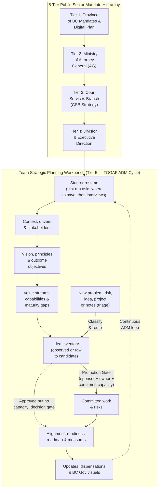
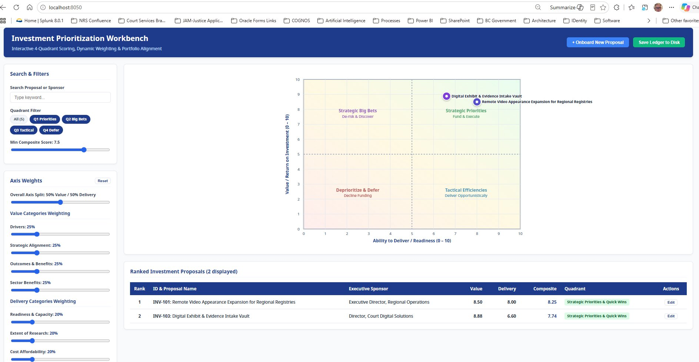

# Strategic Planning Workbench

An APM-native agentic workbench for **organizational, division, and public-sector branch strategic planning, capability-based planning, idea funnel and portfolio management, risk tracking, living register updates, and visual/executive presentation rendering**—tailored for the **BC Government / Ministry of Attorney General / Court Services Branch (CSB)** multi-tier context.

## What This Workbench Is About

Conventional product management tools and AI plugins focus on downstream delivery: feature specs, user stories, sprint backlogs, and product launches. Conversely, enterprise architecture toolkits often jump straight into technical infrastructure or heavyweight compliance artifacts.

Government divisions, branches, and teams translating leadership direction into action face a different challenge:
1. **Multi-Tier Mandate Alignment**: A team's strategy must align upward through **Division**, **Branch (Court Services Branch)**, **Ministry (Ministry of Attorney General)**, and **Province-Wide (BC Government)** mandates and service plans.
2. **Bridging Vision to Capabilities before Solutions**: Moving from *"who are the players and what are our problems?"* to *"what must our organization be able to do (capabilities)?"* before jumping into projects or technology tools.
3. **Keeping Vision, Ideas, and Committed Work Separate**: Preventing brainstormed ideas or exploratory prototypes from being confused with funded, approved commitments.
4. **Living Registers & Executive Visuals**: Capturing, saving, and incrementally updating evolving priorities, new drivers, stakeholder concerns, and work progress over time—and rendering them on demand into **Mermaid roadmaps, Gantt charts, alignment diagrams, and leadership presentations**.

## Core Principles & Non-Negotiable Guardrails

1. **Five-Tier Organizational Line of Sight**
   - Explicitly traces team vision and strategic objectives (`OBJ-X`) upward through **Division**, **Branch (CSB)**, **Ministry (AG)**, and **Province-Wide (BC Gov)** goals while distinguishing `Confirmed` direction from `Interpreted` remarks.
2. **Three Distinct Layers & Inventories, and Commitment Needs Evidence**
   - **Strategic Vision, Logic Models, Value Streams & Capabilities**: *Where are we trying to go, why does it matter, what causal results pathways connect inputs to public outcomes, and what must our organization be able to do?*
   - **Idea Inventory (`IDEA-X`)**: *What might we do?* Captures problems, opportunities, solutions, and experiments across maturity states (ideas: `raw` → `explored` → `validated` → `candidate` → `deferred` / `rejected`; problems: `observed` → `validated` → `sized` → `addressed` → `resolved`) without forcing premature scoring.
   - **Committed Work Inventory (`WORK-X`)**: *What are we actually doing or committed to doing?* Tracks approved initiatives, projects, work packages, time-boxed experiments, and operational responsibilities.
   - **Commitment evidence**: Work is committed only with a named sponsor and approval date, a named owner, and confirmed capacity with its source. Approval without capacity stays a decision gate flagged `Capacity unconfirmed`.
3. **Evidence Over Invention & No Premature Solutioning**
   - Separates documented facts from unproven assumptions (`ASM-X`) and evidence gaps (`GAP-X`). Never fabricates baseline metrics (`Baseline Needed`) or prescribes software/project wish lists before establishing outcome objectives and required capabilities.
4. **TOGAF ADM Methodology in Plain Language**
   - Translates high-value **TOGAF ADM** practices—4-part Operating Principles (`PRN-X`), Stakeholder Viewpoints, Value Stream cross-mapping (`VST-X`), Business Transformation Readiness Assessments (`BTRA`), Transition State Plateaus (`PLT-X`), and Phase H Change Triage / Time-Boxed Dispensations (`DSP-X`)—into conversational, jargon-free guidance.
5. **Guided, Interactive Conversations**
   - Every skill walks the user through the process with numbered menus, one or two questions per turn, progress indicators, "I don't know" accepted as an open item, and a recap before anything is saved.
6. **Living Registers with Non-Destructive Updates**
   - Saves and maintains a session scorecard (`00`) plus 11 canonical markdown registers (`01`–`11`) in `strategy/` with stable IDs, fixed section ownership, a change-log, and an `Open follow-ups` table so changes that touch another owner's records stay visible until applied.

## The Living Strategic Registers (`strategy/` or `~/strategic-planning-outputs/<team>/strategy/`)

When you first use the workbench, `developing-and-managing-strategy` asks where you want to store your strategy files—recommending a dedicated user folder outside the template repo (such as `~/strategic-planning-outputs/<team-name>/strategy/` or `./strategy/` in your current workspace)—and where any existing source documents live. On later sessions it finds the folder again, reads the status scorecard, and resumes where you left off.

| Register | What It Records & Tracks |
|---|---|
| `strategy/00-planning-session-status.md` | Front-door session scorecard: TOGAF ADM stage progress, register status (`Not started` / `Draft` / `Baseline confirmed`), open assumptions, pending promotion gates, active dispensations (`DSP-X`), the `Open follow-ups` table, and next recommended step |
| `strategy/01-org-hierarchy-and-context.md` | 5-Tier direction (Province, AG, CSB, Division, Team), business drivers (`DRV-X`: the pressures that make change necessary), and current-state summary |
| `strategy/02-stakeholders-and-concerns.md` | Stakeholder power/interest analysis ("the players"), core concerns, TOGAF Phase A viewpoints, and perspective tensions |
| `strategy/03-target-vision-and-objectives.md` | Target future-state vision, 4-part TOGAF operating principles (`PRN-X`), and outcome-oriented strategic objectives (`OBJ-X`) |
| `strategy/04-expected-benefits-and-value.md` | Expected public, service, operational, workforce, risk-reduction, and financial value (`BEN-X`) |
| `strategy/05-business-capabilities.md` | End-to-end service value streams (`VST-X`), required organizational capabilities (`CAP-X`), and 5-pillar maturity gaps |
| `strategy/06-constraints-assumptions-risks.md` | Fixed constraints (`CON-X`), unvalidated assumptions (`ASM-X`), evidence gaps (`GAP-X`), and strategic risks (`RSK-X`) with likelihood, severity, proximity, and response |
| `strategy/07-idea-inventory.md` | Problems, opportunities, solutions, and experiments (`IDEA-X`) across the promotion funnel |
| `strategy/08-work-inventory.md` | Committed initiatives, projects, work packages, active experiments, operational responsibilities (`WORK-X`), and progress updates |
| `strategy/09-alignment-traceability-matrix.md` | End-to-end traceability chain, the 8 portfolio diagnostic checks (orphaned work, duplicates, capability blind spots), and TOGAF Transformation Readiness (`BTRA`) |
| `strategy/10-roadmap-and-success-measures.md` | Roadmap (`Now / Next / Later`), TOGAF Transition State plateaus (`PLT-X`), and decision gates (`GATE-X`); outcome/leading/guardrail measures (`MSR-X`) |
| `strategy/11-team-skills-and-allocation.md` | Team member roster (`MEM-X`), skills, growth interests, active `WORK-X` assignments with capacity evidence, key-person risk diagnostics, Mermaid workload charts, and Excel CSV tracker |

## Skills in `plugins/strategic-planning` (5 Skills)

| You want to... | Use |
|---|---|
| Start, resume or update your strategy; or work on a named idea, project, risk, score or roadmap | `developing-and-managing-strategy` |
| Sort a pile of notes, or log a new problem, risk, driver, training request, decision or blocker | `triaging-new-items` |
| Record who is on the team, their skills and capacity | `managing-team-skills-and-allocation` |
| Model how activities lead to outcomes | `designing-logic-models` |
| Make a diagram, dashboard or leadership deck | `rendering-strategic-visuals-and-decks` |

| Skill | Purpose | Primary Outputs |
|---|---|---|
| `developing-and-managing-strategy` | Entry point. First run asks where to save and runs the strategic interview; afterwards it resumes, revisits and updates the plan. 13 modes in four groups: **Establish direction** (Cycle, Context, Vision, Capabilities), **Change direction** (Update), **Manage items** (Ideas, Work, Risks, Score), **Review alignment and delivery** (Alignment, Measures, Roadmap, Review). | Planning Session Status, Register Update Changelog, Strategic Context Brief, Stakeholder Map, Assumptions & Evidence Register, Strategy on a Page, Vision Brief, Benefits Dependency Map, Shared Vision Model, Capability Map, Idea Inventory, Work Inventory, Risk Register, Investment Scoring Ledger (JSON/CSV) and Brief, Alignment Traceability Matrix, Transformation Readiness Assessment, Success Measures Register, Strategic Roadmap |
| `triaging-new-items` | Classifies new, mixed or unclear material by commitment state and nature (problem, driver, risk, idea, project, training, decision, blocker, and more) and routes each item to the right mode or skill. Writes only a triage log. | Intake Triage Log |
| `managing-team-skills-and-allocation` | Map team members, current skills, growth interests, and active `WORK-X` assignments; supply capacity evidence for commitments; detect key-person bottlenecks and export Excel/CSV & Mermaid visuals. | Team Skills & Allocation Register, Excel Work Tracker CSV, Mermaid Workload Diagrams |
| `designing-logic-models` | Design, review, and document program logic models, results chains, outcome chains, theories of change, and results frameworks connecting inputs and activities to outputs and successive outcomes. | Logic Model & Results Chain (`logic-model-template.md`), BC Gov Mermaid Diagrams, Logframe Measurement Matrix |
| `rendering-strategic-visuals-and-decks` | Render Mermaid alignment trees, value-stream maps, capability charts, horizon/Gantt roadmaps, B.C. Gov HTML dashboards, and executive slide decks from the registers. Work that is not fully evidenced is drawn as a decision gate, not a committed bar. | Visual Strategy Package (Mermaid), B.C. Gov HTML Dashboard, Executive Strategy Deck |

## Interactive Investment Prioritization & 4-Quadrant Workbench

The `developing-and-managing-strategy` skill (Score mode) includes a standalone, zero-dependency interactive dashboard (`interactive_investment_app.py`) for evaluating candidate investments, requests for funding (RFF), and proposed project portfolios:

- **Dynamic Quadrant Filtering**: Instantly toggle visibility for Q1 (*Strategic Priorities & Quick Wins*), Q2 (*Strategic Big Bets*), Q3 (*Tactical Efficiencies*), and Q4 (*Deprioritize & Defer*).
- **Live Search & Score Thresholds**: Filter proposals dynamically by name, sponsor, division, or composite score.
- **Real-Time Weight Sliders**: Adjust the overall Value vs. Delivery balance (e.g., 50/50 vs 70/30) and individual category weights to see scatter bubbles re-plot in real time. Saved weights are reloaded on the next run.
- **Commitment Evidence Check**: Each proposal shows `Committable`, `Capacity unconfirmed` or `Evidence incomplete`. A top-right proposal without confirmed capacity is held as a decision gate, not recommended for funding.
- **Score History**: Changed scores or weights keep the previous scores, date, scorer and framework version in each proposal's history. Lossless JSON and CSV ledgers are saved after a confirmation step.
- **Self-check**: `python plugins/strategic-planning/.apm/skills/developing-and-managing-strategy/scripts/test_investment_scripts.py` runs regression checks for the scripts.

## Repository Navigation & Contribution Workflow

> **Protected `main` Branch**: Direct pushes to `main` are disabled. Always create a feature branch (`feat/*`, `fix/*`, `docs/*`), keep [AGENTS.md](AGENTS.md), [architecture.md](architecture.md), and [README.md](README.md) synchronized when skills or registers change, run the compliance audits in [INSTALL.md](INSTALL.md), and open a Pull Request.

- **[INSTALL.md](INSTALL.md)** — Global and project-local APM installation (including Claude, GitHub Copilot, Codex, Antigravity `agy`, and GrokBot `grok-bot`/`grok-build`/`grok-cloud`), update, rollback, and marketplace instructions.
- **[AGENTS.md](AGENTS.md)** — Canonical root agent instructions and non-negotiable invariants.
- **[architecture.md](architecture.md)** — Deep-dive architecture: 5-tier BC Gov / CSB hierarchy, TOGAF ADM stage mapping, 3-inventory model and item lifecycle, 12 living strategy files (`00`–`11`) with section ownership, skill routing, and APM structure.
- **[docs/governance.md](docs/governance.md)** — APM packaging, branch protection, and governance policy.
- **[plugins/strategic-planning/README.md](plugins/strategic-planning/README.md)** — Plugin documentation and skill directory tree.

## License

Licensed under the [Apache License, Version 2.0](LICENSE) (Copyright Province of British Columbia). See [CODE_OF_CONDUCT.md](CODE_OF_CONDUCT.md) for contributor guidelines.
