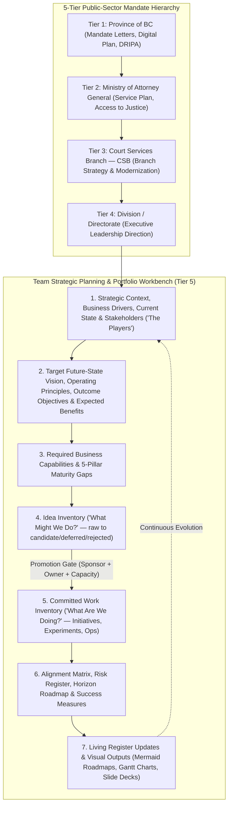

# Strategic Planning Workbench

An APM-native agentic workbench for **organizational, division, and public-sector branch strategic planning, capability-based planning, idea funnel management, portfolio alignment, living register updates, and visual/executive presentation rendering**—tailored for the **BC Government / Ministry of Attorney General / Court Services Branch (CSB)** multi-tier context.

## What This Workbench Is About

Conventional product management tools and AI plugins focus on downstream delivery: feature specs, user stories, sprint backlogs, and product launches. Conversely, enterprise architecture toolkits often jump straight into technical infrastructure or heavyweight compliance artifacts.

Government divisions, branches, and teams translating leadership direction into action face a different challenge:
1. **Multi-Tier Mandate Alignment**: A team's strategy must align upward through **Division**, **Branch (Court Services Branch)**, **Ministry (Ministry of Attorney General)**, and **Province-Wide (BC Government)** mandates and service plans.
2. **Bridging Vision to Capabilities before Solutions**: Moving from *"who are the players and what are our problems?"* to *"what must our organization be able to do (capabilities)?"* before jumping into projects or technology tools.
3. **Keeping Vision, Ideas, and Committed Work Separate**: Preventing brainstormed ideas or exploratory prototypes from being confused with funded, approved commitments.
4. **Living Registers & Executive Visuals**: Capturing, saving, and incrementally updating evolving priorities, new drivers, stakeholder concerns, and work progress over time—and rendering them on demand into **Mermaid roadmaps, Gantt charts, alignment diagrams, and leadership presentations**.

## Core Principles & Non-Negotiable Guardrails

1. **Five-Tier Organizational Line of Sight**
   - Explicitly traces team vision and strategic objectives (`OBJ-X`) upward through **Division**, **Branch (CSB)**, **Ministry (AG)**, and **Province-Wide (BC Gov)** goals while distinguishing `Confirmed` direction from `Interpreted` remarks.
2. **Three Distinct Layers & Inventories**
   - **Strategic Vision & Capabilities**: *Where are we trying to go, why does it matter, and what must our organization be able to do?*
   - **Idea Inventory (`IDEA-X`)**: *What might we do?* Captures raw opportunities, experiments, and proposals across maturity states (`raw` → `explored` → `validated` → `candidate` → `deferred` / `rejected`) without forcing premature scoring.
   - **Committed Work Inventory (`WORK-X`)**: *What are we actually doing or committed to doing?* Tracks approved initiatives, time-boxed active experiments, and operational responsibilities with verified sponsorship and ownership.
3. **Evidence Over Invention & No Premature Solutioning**
   - Separates documented facts from unproven assumptions (`ASM-X`) and evidence gaps (`GAP-X`). Never fabricates baseline metrics (`Baseline Needed`) or prescribes software/project wish lists before establishing outcome objectives and required capabilities.
4. **Living Registers with Non-Destructive Updates**
   - Saves and maintains 10 canonical markdown registers in `strategy/` with stable IDs and change-log history as priorities evolve and work progresses.

## The 10 Living Strategic Registers (`strategy/`)

| Register | What It Records & Tracks |
|---|---|
| `strategy/01-org-hierarchy-and-context.md` | 5-Tier direction (Province, AG, CSB, Division, Team), business drivers (problems/opportunities), and current-state summary |
| `strategy/02-stakeholders-and-concerns.md` | Stakeholder power/interest analysis ("the players" Kyron identified), core concerns, desired outcomes, and perspective tensions |
| `strategy/03-target-vision-and-objectives.md` | Target future-state vision, operating principles, and outcome-oriented strategic objectives (`OBJ-X`) |
| `strategy/04-expected-benefits-and-value.md` | Expected public, service, operational, workforce, risk-reduction, and financial value (`BEN-X`) |
| `strategy/05-business-capabilities.md` | Required organizational capabilities (`CAP-X`) and 5-pillar maturity gaps (People, Process, Data, Tech, Governance) |
| `strategy/06-constraints-assumptions-risks.md` | Fixed constraints (`CON-X`), unvalidated assumptions (`ASM-X`), evidence gaps (`GAP-X`), and strategic risks (`RSK-X`) |
| `strategy/07-idea-inventory.md` | Unapproved ideas, opportunities, and proposals (`IDEA-X`) across the 7-stage promotion funnel |
| `strategy/08-work-inventory.md` | Committed initiatives, active experiments, operational responsibilities (`WORK-X`), and progress updates |
| `strategy/09-alignment-traceability-matrix.md` | End-to-end traceability chain and the 8 portfolio diagnostic checks (orphaned work, duplicates, capability blind spots) |
| `strategy/10-roadmap-and-success-measures.md` | High-level sequencing (`Now / Next / Later`), decision gates (`GATE-X`), and outcome/leading/guardrail measures (`MSR-X`) |
| `strategy/11-team-skills-and-allocation.md` | Team member roster (`MEM-X`), skills, growth interests, active `WORK-X` assignments, key-person risk diagnostics, Mermaid workload charts, and Excel CSV tracker |

## Skills in `plugins/strategic-planning`

| Skill | Purpose | Primary Outputs |
|---|---|---|
| `analyzing-strategic-context` | Capture multi-tier leadership direction, business drivers, stakeholder power/interests ("the players"), current state, and assumptions. | Strategic Context Brief, Stakeholder Map, Assumptions & Evidence Register |
| `defining-strategic-vision` | Articulate target future state, operating principles, outcome-oriented strategic objectives, and expected public/business value. | Strategy on a Page, Strategic Vision Brief, Benefits Dependency Map |
| `planning-business-capabilities` | Translate vision and objectives into required organizational capabilities and assess 5-pillar maturity gaps. | Capability Map & Gap Assessment |
| `managing-idea-inventory` | Capture, clarify, stress-test, and evaluate unapproved ideas through a structured promotion funnel. | Idea Inventory, Idea Record, Idea Evaluation Brief |
| `managing-work-inventory` | Maintain the portfolio of committed initiatives, active experiments, and operational work linked to sponsors and owners. | Work Inventory |
| `managing-team-skills-and-allocation` | Map team members, current skills, growth interests, and active `WORK-X` assignments; detect key-person bottlenecks and export Excel/CSV & Mermaid visuals. | Team Skills & Allocation Register, Excel Work Tracker CSV, Mermaid Workload Diagrams |
| `aligning-strategy-and-portfolio` | Audit end-to-end traceability (Province/AG/CSB → Vision → Objectives → Capabilities → Ideas → Work) and strategic risks. | Alignment Traceability Matrix, Strategic Risk Register |
| `sequencing-roadmaps-and-measures` | Sequence committed work into Now/Next/Later or Three Horizons roadmaps with decision gates, OKRs, leading indicators, and guardrails. | Strategic Roadmap, Success Measures Register |
| `updating-strategic-registers` | Import and incrementally update evolving priorities, new drivers, stakeholder shifts, new ideas, and work progress across living registers. | Multi-Tier Mandate Register, Register Update & Progress Changelog |
| `rendering-strategic-visuals-and-decks` | Render Mermaid alignment trees, capability charts, horizon/Gantt roadmaps, B.C. Gov HTML dashboards, and executive slide decks. | Visual Strategy Package (Mermaid), B.C. Gov HTML Dashboard, Executive Strategy Deck |

## Repository Navigation

- **[INSTALL.md](INSTALL.md)** — Global and project-local APM installation, update, rollback, and marketplace instructions.
- **[AGENTS.md](AGENTS.md)** — Canonical root agent instructions and non-negotiable invariants.
- **[architecture.md](architecture.md)** — Deep-dive architecture: 5-tier BC Gov / CSB hierarchy, 3-inventory model, 10 living registers, and APM structure.
- **[docs/governance.md](docs/governance.md)** — APM packaging and governance policy.
- **[plugins/strategic-planning/README.md](plugins/strategic-planning/README.md)** — Plugin documentation and skill directory tree.

## License

Licensed under the [Apache License, Version 2.0](LICENSE) (Copyright Province of British Columbia). See [CODE_OF_CONDUCT.md](CODE_OF_CONDUCT.md) for contributor guidelines.
