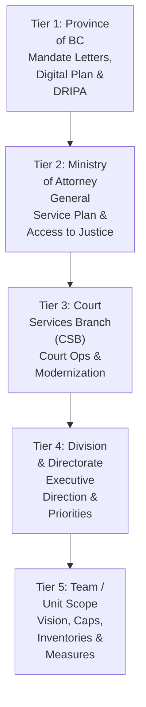
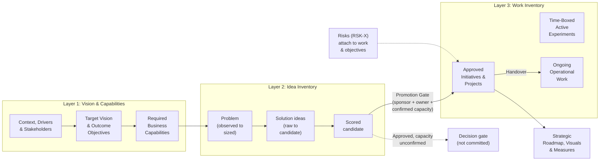
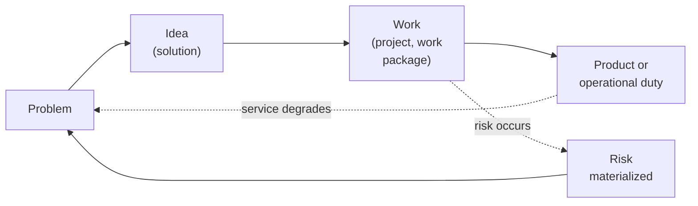
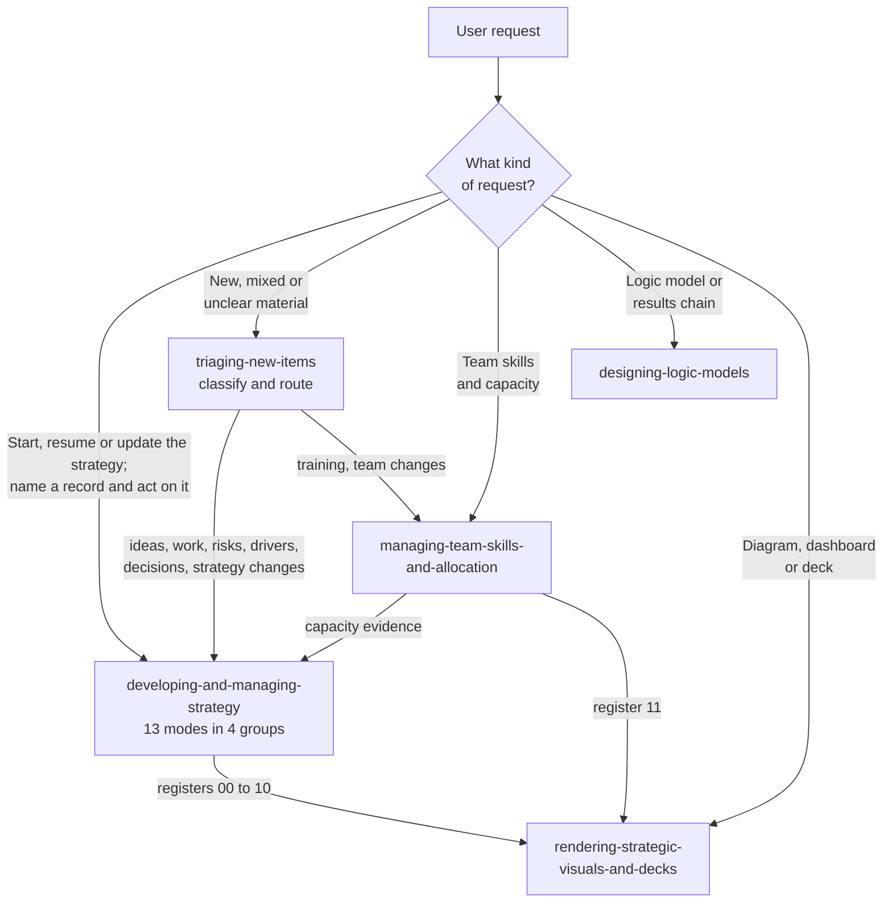
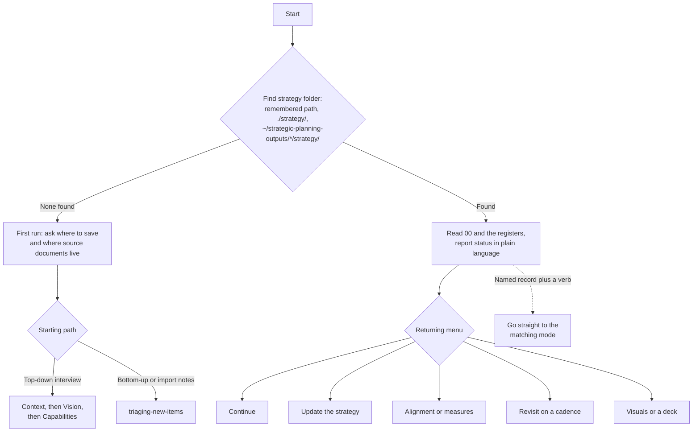
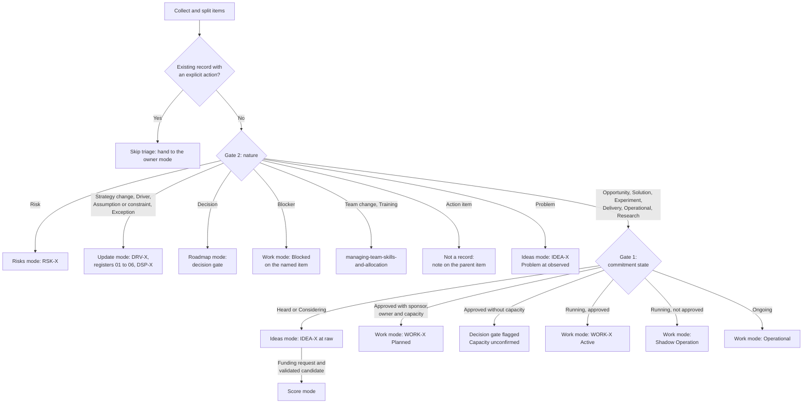

# Architecture & Strategic Planning Model (`architecture.md`)

## Contents

- [1. Purpose & System Overview](#1-purpose--system-overview)
- [2. Five-Tier Public-Sector Organizational Hierarchy (BC Gov / AG / CSB)](#2-five-tier-public-sector-organizational-hierarchy-bc-gov--ag--csb)
- [3. The Three-Inventory Separation Model & Item Lifecycle](#3-the-three-inventory-separation-model--item-lifecycle)
- [4. Canonical Living Strategic Registers (`strategy/`)](#4-canonical-living-strategic-registers-strategy)
- [5. Skill Set & Request Routing](#5-skill-set--request-routing)
- [6. End-to-End Skill Lifecycle & Continuous Update Loop](#6-end-to-end-skill-lifecycle--continuous-update-loop-togaf-adm-aligned)
- [7. Repository & APM-Native Plugin Structure](#7-repository--apm-native-plugin-structure)
- [8. Branch Protection, PR Workflow & Documentation Synchronization](#8-branch-protection-pr-workflow--documentation-synchronization)

---

## 1. Purpose & System Overview

`strategic-planning-workbench` is an APM-native agentic workbench designed for **government and organizational strategic planning**. Rather than jumping prematurely from stakeholder conversations into feature backlogs or project wish lists, the workbench maintains a structured, evidence-backed chain from multi-tier leadership direction down to capabilities, candidate ideas, committed work, risks, and measurable outcomes.

The plugin has five skills. One main skill, `developing-and-managing-strategy`, holds the strategy interview, the living registers, and the idea, work, risk, scoring and roadmap modes. A triage skill sorts new material, and three specialist skills handle team capacity, logic models, and visuals. Every skill is interactive: it guides the user with menus and one or two questions at a time, and confirms a recap before saving.

---

## 2. Five-Tier Public-Sector Organizational Hierarchy (BC Gov / AG / CSB)

Teams and units in government do not invent strategy in a vacuum; their strategic vision and objectives align upward through a multi-tier organizational structure while preserving clear scope boundaries at each level:



| Organizational Tier | Primary Artifacts & Signals | How the Team Uses It |
|---|---|---|
| **Tier 1: Province of BC** | Mandate Letters, BC Digital Plan, DRIPA Action Plan, CleanBC, Accessibility & FOIPPA statutes | Foundational policy, legislative, and public-value guardrails. |
| **Tier 2: Ministry of Attorney General (AG)** | Ministry Service Plan, Justice & Public Safety sector goals, Access to Justice commitments | Sector-level outcomes and non-negotiable judicial/operational independence boundaries. |
| **Tier 3: Court Services Branch (CSB)** | Branch strategic plan, court registry modernization, digital court operations, security/sheriff priorities | Branch-wide strategic themes and shared capability priorities. |
| **Tier 4: Division / Directorate** | Executive Director / Director communications, divisional priorities, funding bounds | Direct upstream leadership direction (`Confirmed` vs. `Interpreted`). |
| **Tier 5: Team / Unit** | Team Strategy on a Page, Strategic Vision Brief, Capability Map, Idea Inventory, Work Inventory, Roadmap | Directly authored, maintained, and executed by the team. |

---

## 3. The Three-Inventory Separation Model & Item Lifecycle

To prevent teams from confusing a casual suggestion or an exploratory prototype with funded, committed work, the workbench enforces three distinct layers. Moving from the second layer to the third requires **commitment evidence**: a named sponsor with approval date, a named owner, and confirmed capacity with its source. Approval without capacity keeps an item as a decision gate flagged `Capacity unconfirmed`; it is never shown as committed work or as a committed roadmap bar.



Records are never changed into another type. A transition creates a new record in the next register and links back, so history stays intact:



Each record type has states, review triggers and closure rules (for example, work cannot close without a named service owner or an explicit retirement). Scores are dated snapshots that are re-run when assumptions or weights change. These rules live in the lifecycle reference of `developing-and-managing-strategy`.

---

## 4. Canonical Living Strategic Registers (`strategy/`)

On first use, `developing-and-managing-strategy` asks where to save (recommending `~/strategic-planning-outputs/<team-name>/strategy/` so live branch plans stay separate from the template repository, or `./strategy/` inside a dedicated project workspace) and where existing reference documents live. The living knowledge is captured, saved, and incrementally updated across 12 structured markdown files (typically stored in `strategy/`). Each is written by one mode, listed below:

| Register File | Core Question Answered | Writing Mode or Skill |
|---|---|---|
| `strategy/00-planning-session-status.md` | *Where are we in the 6-stage TOGAF ADM strategic planning cycle, what is complete vs. missing, which follow-ups are open, and what is our next 15-minute step?* | `developing-and-managing-strategy` (Cycle) |
| `strategy/01-org-hierarchy-and-context.md` | *What have Provincial, Ministry (AG), Branch (CSB), and Division leaders communicated, and what are our business drivers (`DRV-X`) and current-state realities?* | Context, Update |
| `strategy/02-stakeholders-and-concerns.md` | *Who are "the players" (internal, external, judicial, partners), what are their interests/concerns, what TOGAF Phase A viewpoints do they need, and where do perspectives conflict?* | Context, Update |
| `strategy/03-target-vision-and-objectives.md` | *What is our target future state, 4-part TOGAF operating principles (`PRN-X`), and outcome-oriented strategic objectives (`OBJ-X`)?* | Vision, Update |
| `strategy/04-expected-benefits-and-value.md` | *What public, service, operational, workforce, risk-reduction, and financial value (`BEN-X`) will those objectives deliver?* | Vision, Update |
| `strategy/05-business-capabilities.md` | *Across our end-to-end value streams (`VST-X`), what must our team/branch be able to do (`CAP-X`), and where are the 5-pillar maturity gaps?* | Capabilities, Update |
| `strategy/06-constraints-assumptions-risks.md` | *What fixed constraints (`CON-X`) bind us, what unproven assumptions (`ASM-X`) and evidence gaps (`GAP-X`) need validation, and what strategic risks (`RSK-X`) exist?* | Constraints, assumptions and gaps: Context, Update. Risks: Risks |
| `strategy/07-idea-inventory.md` | *What problems, opportunities, solutions and experiments (`IDEA-X`) are we exploring, deferring, or evaluating?* | Ideas |
| `strategy/08-work-inventory.md` | *What approved initiatives, projects, work packages, experiments, and operational duties (`WORK-X`) are we committed to doing, and what is their current progress?* | Work |
| `strategy/09-alignment-traceability-matrix.md` | *How does everything connect from Province/Ministry/CSB down to team work, where are the orphans, duplicates, or gaps, and what is our TOGAF Business Transformation Readiness (`BTRA`)?* | Alignment |
| `strategy/10-roadmap-and-success-measures.md` | *How is committed work sequenced (`Now / Next / Later`), what are the TOGAF Transition State plateaus (`PLT-X`) and decision gates (`GATE-X`), and how is success measured (`MSR-X`)?* | Roadmap section: Roadmap. Measures section: Measures |
| `strategy/11-team-skills-and-allocation.md` | *Who is on our team (`MEM-X`), what are their skills and growth interests, which `WORK-X` items are assigned to them with what confirmed capacity, and where are our key-person bottlenecks?* | `managing-team-skills-and-allocation` |

Registers `06` and `10` have fixed section headings so two owners can share a file safely: `06` holds Constraints (`CON-`), Assumptions (`ASM-`), Evidence gaps (`GAP-`) and Risks (`RSK-`); `10` holds Roadmap and decision gates (`PLT-`, `GATE-`) and Success measures (`MSR-`).

**Shared bookkeeping contract.** A mode edits only the sections it owns and never deletes records. When a change touches records another mode or skill owns (an objective change that affects work, risks and the roadmap, or a new allocation that clears a capacity flag), it lists them by ID and adds one row each to the `Open follow-ups` table in `00`. A follow-up closes only when the owner applies and logs the change. Every confirmed change is appended to `changelog.md`. The contract is carried by `developing-and-managing-strategy` and `managing-team-skills-and-allocation`.

---

## 5. Skill Set & Request Routing

Five skills, with one main entry point:



### 5.1 `developing-and-managing-strategy`: modes

| Group | Mode | Writes |
|---|---|---|
| Establish direction | **Cycle** | `00`: finds the strategy folder, first run or resume, revisit cadences |
| | **Context** | `01`, `02`, constraints/assumptions/gaps in `06` |
| | **Vision** | `03`, `04` |
| | **Capabilities** | `05` |
| Change direction | **Update** | Strategy changes in `01`–`06`; dispensations (`DSP-X`); raises follow-ups |
| Manage items | **Ideas** | `07` |
| | **Work** | `08` |
| | **Risks** | Risks section of `06` |
| | **Score** | Scoring ledger (JSON and CSV) for candidates; no register directly |
| Review alignment and delivery | **Alignment** | `09`, including `BTRA` |
| | **Measures** | Success measures section of `10` |
| | **Roadmap** | Roadmap and decision gates section of `10` |
| | **Review** | Lifecycle review of items and open follow-ups |

### 5.2 Entry behavior



A half-finished interview resumes at the next unfinished step. If `00` is missing but registers exist, they are adopted rather than restarted. If more than one candidate folder exists, the user is asked which to use before anything is created.

### 5.3 Triage routing (`triaging-new-items`)

New, mixed or unclear material is classified by commitment state (Gate 1) and nature (Gate 2). Natures that are not commitments skip Gate 1. A funding or investment ask is a flag, never a shortcut past validation. Triage writes only a log; the receiving mode creates the record.



### 5.4 Specialist skills

| Skill | Role | Boundary |
|---|---|---|
| `managing-team-skills-and-allocation` | Writes register `11`: skills, growth interests, allocations. An allocation with who confirmed it, when and the source is the capacity evidence the main skill needs before work can be committed. | Never approves work; clears a `Capacity unconfirmed` flag only by raising a follow-up |
| `designing-logic-models` | Builds logic models, results chains and theories of change; produces a model artifact | Writes no registers |
| `rendering-strategic-visuals-and-decks` | Reads the registers and renders Mermaid diagrams (including the roadmap Gantt), HTML dashboards and decks | Writes no register content; draws work that lacks commitment evidence as decision gates |

---

## 6. End-to-End Skill Lifecycle & Continuous Update Loop (TOGAF ADM Aligned)

0. **Entry & Cycle Orchestration (`developing-and-managing-strategy` — Cycle mode — TOGAF ADM Cycle Coach, Revisit Guide & GrokBot Ready)**:
   Finds the strategy folder, runs the first-time setup or resumes, offers the returning menu (continue, update, alignment or measures, revisit on a cadence, visuals), and updates `strategy/00-planning-session-status.md`.
1. **Initial Baseline (`developing-and-managing-strategy` — Context, Vision and Capabilities modes — ADM Preliminary, Phase A & Phase B)**:
   Establishes multi-tier context, drivers, stakeholder viewpoints, current state, target vision, 4-part TOGAF operating principles (`PRN-X`), outcome objectives (`OBJ-X`), benefits (`BEN-X`), value streams (`VST-X`), and required capabilities (`CAP-X`).
2. **Causal Pathway Modeling (`designing-logic-models` — ADM Phase B & Phase E)**:
   Connects inputs and activities to outputs and progressive immediate, intermediate, and long-term public outcomes for specific programs, strategic objectives (`OBJ-X`), or committed initiatives (`WORK-X`), stress-testing causal hypotheses, assumptions, and logframe indicators.
3. **Item Intake, Development, Scoring & Team Allocation (`triaging-new-items`, `developing-and-managing-strategy` — Ideas, Work, Risks, Score and Review modes — & `managing-team-skills-and-allocation` — ADM Phase E)**:
   Sorts new material, separates possibilities (`IDEA-X`) from committed work (`WORK-X`), tracks risks (`RSK-X`), evaluates candidate investments across Value/ROI and Ability to Deliver using weighted 4-quadrant scoring, enforces the Promotion Gate with commitment evidence, and maps team skills, growth interests, and `MEM-X` capacity.
4. **Alignment, Readiness & Plateau Sequencing (`developing-and-managing-strategy` — Alignment, Measures and Roadmap modes — ADM Phase E & Phase F)**:
   Audits the full traceability chain, assesses TOGAF Business Transformation Readiness (`BTRA`), defines Transition State plateaus (`PLT-X`) and decision gates across horizons, and establishes balanced measures (`MSR-X`).
5. **Living Update, Change Triage & Dispensations (`developing-and-managing-strategy` — Update mode, with `triaging-new-items` — ADM Phase G, Phase H & Requirements Management)**:
   Imports new meeting notes, evolving leadership priorities, new business drivers, assumptions and constraints, and time-boxed strategic dispensations (`DSP-X`) while preserving stable IDs, listing affected records as open follow-ups, and appending to the change log.
6. **Visual & Executive Rendering (`rendering-strategic-visuals-and-decks`)**:
   Generates Mermaid roadmaps, Gantt/horizon charts, value-stream maps, capability charts, alignment flowcharts, B.C. Gov HTML Strategy on a Page dashboards, and executive presentation decks directly from the living registers.

---

## 7. Repository & APM-Native Plugin Structure

```text
strategic-planning-workbench/
├── .agent/
│   └── rules/
│       ├── apm-plugin-hygiene.md
│       ├── evidence-and-hierarchy-alignment.md
│       └── three-inventory-separation.md
├── .claude-plugin/
│   └── marketplace.json
├── .gitignore
├── AGENTS.md
├── CLAUDE.md
├── README.md
├── apm.yml
├── architecture.md
├── docs/
│   └── governance.md
└── plugins/
    └── strategic-planning/
        ├── .apm/
        │   └── skills/
        │       ├── designing-logic-models/
        │       ├── developing-and-managing-strategy/
        │       │   ├── SKILL.md              (router: 13 modes in 4 groups)
        │       │   ├── assets/templates/     (registers, ledgers, briefs)
        │       │   ├── evals/
        │       │   ├── references/           (one folder per mode, plus workflows/, shared/, lifecycle/)
        │       │   └── scripts/              (scoring generator, dashboard, vision generator, tests)
        │       ├── managing-team-skills-and-allocation/
        │       ├── rendering-strategic-visuals-and-decks/
        │       └── triaging-new-items/
        ├── .claude-plugin/
        │   └── plugin.json
        ├── README.md
        ├── apm.yml
        └── rules/
            ├── apm-plugin-hygiene.md
            ├── evidence-and-hierarchy-alignment.md
            └── three-inventory-separation.md
```

---

## 8. Branch Protection, PR Workflow & Documentation Synchronization

`main` is branch-protected on `bcgov/strategic-planning-workbench`:
1. **Feature-Branch PR Workflow**: All changes must be made on a dedicated branch (`feat/<topic>`, `fix/<topic>`, `docs/<topic>`, `refactor/<topic>`) and submitted via Pull Request.
2. **Documentation Synchronization**: Any change that adds, renames, or modifies skills, living registers (`strategy/00`–`11`), or architectural invariants must update [AGENTS.md](AGENTS.md), [architecture.md](architecture.md), [README.md](README.md), and [plugins/strategic-planning/README.md](plugins/strategic-planning/README.md) in the same Pull Request.
3. **Pre-PR Verification**: Run `audit_agents_md.py --strict`, `audit_rule.py --all --strict`, `audit_plugin_structure.py`, `audit.py`, `audit_skill.py --all --mode source` & `--mode installed`, `validate_apm_package.py`, and `audit_marketplace_sources.py` before pushing. Also run `python plugins/strategic-planning/.apm/skills/developing-and-managing-strategy/scripts/test_investment_scripts.py` after changing the scoring scripts or ledger templates.
