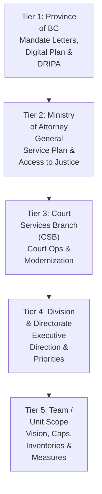
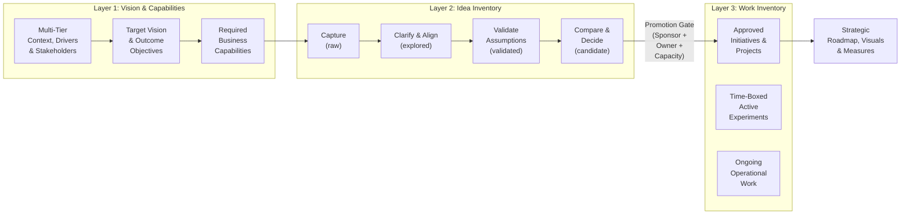

# Architecture & Strategic Planning Model (`architecture.md`)

## Contents

- [1. Purpose & System Overview](#1-purpose--system-overview)
- [2. Five-Tier Public-Sector Organizational Hierarchy (BC Gov / AG / CSB)](#2-five-tier-public-sector-organizational-hierarchy-bc-gov--ag--csb)
- [3. The Three-Inventory Separation Model](#3-the-three-inventory-separation-model)
- [4. Canonical Living Strategic Registers (`strategy/`)](#4-canonical-living-strategic-registers-strategy)
- [5. End-to-End Skill Lifecycle & Continuous Update Loop](#5-end-to-end-skill-lifecycle--continuous-update-loop)
- [6. Repository & APM-Native Plugin Structure](#6-repository--apm-native-plugin-structure)
- [7. Branch Protection, PR Workflow & Documentation Synchronization](#7-branch-protection-pr-workflow--documentation-synchronization)

---

## 1. Purpose & System Overview

`strategic-planning-workbench` is an APM-native agentic workbench designed for **government and organizational strategic planning**. Rather than jumping prematurely from stakeholder conversations into feature backlogs or project wish lists, the workbench maintains a structured, evidence-backed chain from multi-tier leadership direction down to capabilities, candidate ideas, committed work, and measurable outcomes.

---

## 2. Five-Tier Public-Sector Organizational Hierarchy (BC Gov / AG / CSB)

Teams and units in government do not invent strategy in a vacuum; their strategic vision and objectives align upward through a multi-tier organizational structure while preserving clear scope boundaries at each level:



| Organizational Tier | Primary Artifacts & Signals | How the Team Uses It |
|---|---|---|
| **Tier 1: Province of BC** | Mandate Letters, BC Digital Plan, DRIPA Action Plan, CleanBC, Accessibility & FOIPPA statutes | Foundational policy, legislative, and public-value guardrails. |
| **Tier 2: Ministry of Attorney General (AG)** | Ministry Service Plan, Justice & Public Safety sector goals, Access to Justice commitments | Sector-level outcomes and non-negotiable judicial/operational independence boundaries. |
| **Tier 3: Court Services Branch (CSB)** | Branch strategic plan, court registry modernization, digital court operations, security/sheriff priorities | Branch-wide strategic themes and shared capability priorities. |
| **Tier 4: Division / Directorate** | Executive Director / Director communications (e.g., Chris, Jessica), divisional priorities, funding bounds | Direct upstream leadership direction (`Confirmed` vs. `Interpreted`). |
| **Tier 5: Team / Unit** | Team Strategy on a Page, Strategic Vision Brief, Capability Map, Idea Inventory, Work Inventory, Roadmap | Directly authored, maintained, and executed by the team. |

---

## 3. The Three-Inventory Separation Model

To prevent teams from confusing a casual suggestion or an exploratory prototype with funded, committed work, the workbench enforces three distinct layers:



---

## 4. Canonical Living Strategic Registers (`strategy/` or `~/strategic-planning-outputs/<team>/strategy/`)

When a team uses `strategic-planning-workbench` on an active planning engagement, `running-strategic-planning-cycle` first confirms the target output directory (recommending `C:\Users\<username>\strategic-planning-outputs\<team-name>\strategy\` on Windows or `~/strategic-planning-outputs/<team-name>/strategy/` on macOS/Linux so live branch plans stay separate from the template repository, or `./strategy/` inside a dedicated project workspace) and asks where existing reference documents live:

When a team uses `strategic-planning-workbench` on an active planning engagement, its living knowledge is captured, saved, and incrementally updated across 10 structured markdown registers (typically stored in `strategy/`):

| Register File | Core Question Answered | Primary Owning Skills |
|---|---|---|
| `strategy/00-planning-session-status.md` | *Where are we in the 6-stage TOGAF ADM strategic planning cycle, what is complete vs. missing, and what is our next 15-minute step?* | `running-strategic-planning-cycle` |
| `strategy/01-org-hierarchy-and-context.md` | *What have Provincial, Ministry (AG), Branch (CSB), and Division leaders communicated, and what are our business drivers and current-state realities?* | `analyzing-strategic-context`, `updating-strategic-registers` |
| `strategy/02-stakeholders-and-concerns.md` | *Who are "the players" (internal, external, judicial, partners), what are their interests/concerns, what TOGAF Phase A viewpoints do they need, and where do perspectives conflict?* | `analyzing-strategic-context`, `updating-strategic-registers` |
| `strategy/03-target-vision-and-objectives.md` | *What is our target future state, 4-part TOGAF operating principles (`PRN-X`), and outcome-oriented strategic objectives (`OBJ-X`)?* | `defining-strategic-vision`, `updating-strategic-registers` |
| `strategy/04-expected-benefits-and-value.md` | *What public, service, operational, workforce, risk-reduction, and financial value (`BEN-X`) will those objectives deliver?* | `defining-strategic-vision`, `updating-strategic-registers` |
| `strategy/05-business-capabilities.md` | *Across our end-to-end value streams (`VST-X`), what must our team/branch be able to do (`CAP-X`), and where are the 5-pillar maturity gaps?* | `planning-business-capabilities`, `updating-strategic-registers` |
| `strategy/06-constraints-assumptions-risks.md` | *What fixed constraints bind us, what unproven assumptions (`ASM-X`) and evidence gaps (`GAP-X`) need validation, what strategic risks (`RSK-X`) exist, and what is our TOGAF Business Transformation Readiness (`BTRA`)?* | `analyzing-strategic-context`, `aligning-strategy-and-portfolio`, `updating-strategic-registers` |
| `strategy/07-idea-inventory.md` | *What possibilities, opportunities, and proposals (`IDEA-X`) are we exploring, deferring, or evaluating?* | `managing-idea-inventory`, `updating-strategic-registers` |
| `strategy/08-work-inventory.md` | *What approved initiatives, active experiments, and operational duties (`WORK-X`) are we committed to doing, and what is their current progress?* | `managing-work-inventory`, `updating-strategic-registers` |
| `strategy/09-alignment-traceability-matrix.md` | *How does everything connect from Province/Ministry/CSB down to team work, and where are the orphans, duplicates, or gaps?* | `aligning-strategy-and-portfolio` |
| `strategy/10-roadmap-and-success-measures.md` | *How is committed work sequenced (`Now / Next / Later`), what are the TOGAF Transition State plateaus (`PLT-X`) and decision gates, and how is success measured (`MSR-X`)?* | `sequencing-roadmaps-and-measures`, `rendering-strategic-visuals-and-decks` |
| `strategy/11-team-skills-and-allocation.md` | *Who is on our team (`MEM-X`), what are their skills and growth interests, which `WORK-X` items are assigned to them, and where are our key-person bottlenecks?* | `managing-team-skills-and-allocation`, `updating-strategic-registers` |

---

## 5. End-to-End Skill Lifecycle & Continuous Update Loop (TOGAF ADM Aligned)

0. **Front-Door Intake & Cycle Orchestration (`running-strategic-planning-cycle` — TOGAF ADM Cycle Coach)**:
   Scans `strategy/00`–`11`, offers a 5-option plain-language entry menu (Top-Down from leadership direction, Bottom-Up from existing projects/ideas, Resume where we left off, Import meeting notes, or Fast-Track briefing), and updates `strategy/00-planning-session-status.md`.
1. **Initial Baseline (`analyzing-strategic-context` $\rightarrow$ `defining-strategic-vision` $\rightarrow$ `planning-business-capabilities` — ADM Preliminary, Phase A & Phase B)**:
   Establishes multi-tier context, stakeholder viewpoints, current state, target vision, 4-part TOGAF operating principles (`PRN-X`), outcome objectives (`OBJ-X`), benefits (`BEN-X`), value streams (`VST-X`), and required capabilities (`CAP-X`).
2. **Inventory Capture, Team Allocation & Triage (`managing-idea-inventory`, `managing-work-inventory` & `managing-team-skills-and-allocation` — ADM Phase E)**:
   Separates possibilities (`IDEA-X`) from committed work (`WORK-X`), enforces the Promotion Gate, and maps team skills, growth interests, and `MEM-X` capacity.
3. **Alignment, Readiness & Plateau Sequencing (`aligning-strategy-and-portfolio` & `sequencing-roadmaps-and-measures` — ADM Phase E & Phase F)**:
   Audits the full traceability chain, assesses TOGAF Business Transformation Readiness (`BTRA`), logs strategic risks, defines Transition State plateaus (`PLT-X`) across horizons, and establishes balanced measures (`MSR-X`).
4. **Living Ingestion, Change Triage & Dispensations (`updating-strategic-registers` — ADM Phase G, Phase H & Requirements Management)**:
   Imports new meeting notes, evolving leadership priorities, new business drivers, emerging problems, new ideas, status updates, and time-boxed strategic dispensations (`DSP-X`) while preserving stable IDs and change logs.
5. **Visual & Executive Rendering (`rendering-strategic-visuals-and-decks`)**:
   Generates Mermaid roadmaps, Gantt/horizon charts, value-stream maps, capability charts, alignment flowcharts, B.C. Gov HTML Strategy on a Page dashboards, and executive presentation decks directly from the living registers.

---

## 6. Repository & APM-Native Plugin Structure

```text
strategic-planning-workbench/
├── .agent/
│   └── rules/
│       ├── apm-plugin-hygiene.md
│       ├── evidence-and-hierarchy-alignment.md
│       └── three-inventory-separation.md
├── .claude-plugin/
│   └── marketplace.json
├── .gitignore
├── AGENTS.md
├── CLAUDE.md
├── README.md
├── apm.yml
├── architecture.md
├── docs/
│   └── governance.md
└── plugins/
    └── strategic-planning/
        ├── .apm/
        │   └── skills/
        │       ├── aligning-strategy-and-portfolio/
        │       ├── analyzing-strategic-context/
        │       ├── defining-strategic-vision/
        │       ├── managing-idea-inventory/
        │       ├── managing-team-skills-and-allocation/
        │       ├── managing-work-inventory/
        │       ├── planning-business-capabilities/
        │       ├── rendering-strategic-visuals-and-decks/
        │       ├── running-strategic-planning-cycle/
        │       ├── sequencing-roadmaps-and-measures/
        │       └── updating-strategic-registers/
        ├── .claude-plugin/
        │   └── plugin.json
        ├── README.md
        ├── apm.yml
        └── rules/
            ├── apm-plugin-hygiene.md
            ├── evidence-and-hierarchy-alignment.md
            └── three-inventory-separation.md
```

---

## 7. Branch Protection, PR Workflow & Documentation Synchronization

`main` is branch-protected on `bcgov/strategic-planning-workbench`:
1. **Feature-Branch PR Workflow**: All changes must be made on a dedicated branch (`feat/<topic>`, `fix/<topic>`, `docs/<topic>`) and submitted via Pull Request.
2. **Documentation Synchronization**: Any change that adds, renames, or modifies skills, living registers (`strategy/00`–`11`), or architectural invariants must update [AGENTS.md](AGENTS.md), [architecture.md](architecture.md), [README.md](README.md), and [plugins/strategic-planning/README.md](plugins/strategic-planning/README.md) in the same Pull Request.
3. **Pre-PR Verification**: Run `audit_agents_md.py --strict`, `audit_rule.py --all --strict`, `audit_plugin_structure.py`, `audit.py`, `audit_skill.py --all --mode source` & `--mode installed`, `validate_apm_package.py`, and `audit_marketplace_sources.py` before pushing.
