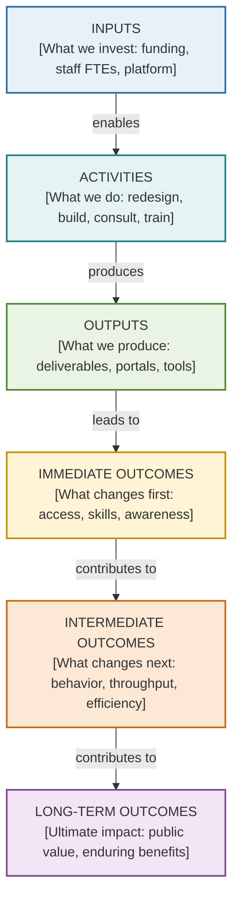

# Logic Model & Results Chain: [Initiative or Objective Name]

> **Status**: Draft | Reviewed | Approved  
> **Date**: [YYYY-MM-DD]  
> **Owning Team**: [Team Name]  
> **Related Register IDs**: `OBJ-[X]`, `WORK-[X]`, `BEN-[X]`, `CAP-[X]`, `MSR-[X]`  
> **Methodology Depth**: Simple | Extended | Measurement-Ready (Logframe)

---

## 1. Context & Problem Statement

- **Need or Problem**: [Describe the current condition, bottleneck, or opportunity that justifies this intervention]
- **Target Population / Beneficiaries**: [Identify the client groups, staff roles, or justice system participants directly affected]
- **Scope & Delivery Bounds**: [Clarify what is inside versus outside the boundary of this initiative]

---

## 2. Canonical Results Chain

---

## 3. Results Chain Matrix

| Stage | Element ID | Statement | Critical Assumptions & External Factors | Target Horizon | Indicators & Verification |
|---|---|---|---|---|---|
| **Inputs** | `INP-01` | [Investment statement] | [Resource availability] | Month 0 | [Budget / FTE tracking] |
| **Activities** | `ACT-01` | [Team work performed] | [Staff availability] | Months 1–3 | [Sprint progress logs] |
| **Outputs** | `OUT-01` | [Deliverable produced] | [Technical dependency] | Month 4 | [Release acceptance] |
| **Immediate Outcomes** | `IMM-01` | [Early user uptake] | [User willingness to adopt] | Months 4–6 | [Active user count] |
| **Intermediate Outcomes** | `INT-01` | [Behavioral shift] | [Process continuity] | Months 6–18 | [Turnaround time reduction] |
| **Long-Term Outcomes** | `LNG-01` | [Enduring public value] | [Partner policy alignment] | Years 2–4 | [Annual client survey] |

---

## 4. Theory of Change Causal Rationale

- **Outputs ──> Immediate Outcomes**: [Explain *why* releasing this output will cause users or staff to change behavior]
- **Immediate ──> Intermediate Outcomes**: [Explain *how* initial adoption translates into sustained operational efficiency]
- **Intermediate ──> Long-Term Outcomes**: [Explain the team's contribution to broader provincial or ministry mandates]

---

## 5. Risk & Validation Audit

- [ ] Activities and outputs are not confused with outcomes (VAL-01, VAL-03).
- [ ] No causal leaps or missing intermediate stepping stones (VAL-07).
- [ ] Technology implementation is treated as an enabler, not the final benefit (VAL-11).
- [ ] Direct control is claimed only for outputs; long-term results state contribution (VAL-05).
