# Canonical Baseline Results Chain (Left-to-Right)

A standard public-sector results pathway demonstrating progressive causal transitions from investments to ultimate public value in horizontal layout (`flowchart LR`).

```mermaid
%%{init: {"flowchart": {"wrappingWidth": 300, "minNodeWidth": 240}} }%%
flowchart LR

I["<b>INPUTS</b><br/>What we invest<br/><br/>Program funding<br/>Staff and expertise<br/>Technology platform<br/>Existing service data"]

A["<b>ACTIVITIES</b><br/>What we do<br/><br/>Map current services<br/>Redesign processes<br/>Build digital services<br/>Train staff"]

O["<b>OUTPUTS</b><br/>What we produce<br/><br/>New online services<br/>Redesigned processes<br/>Staff trained<br/>Guidance and tools published"]

IO["<b>IMMEDIATE OUTCOMES</b><br/>What changes first<br/><br/>Staff gain new capabilities<br/>Services are easier to access<br/>More transactions are digital<br/>Better service data is available"]

MO["<b>INTERMEDIATE OUTCOMES</b><br/>What changes next<br/><br/>Faster service delivery<br/>Fewer manual processes<br/>Lower administrative effort<br/>Improved client experience<br/>Better evidence-based decisions"]

LO["<b>LONG-TERM OUTCOMES</b><br/>Ultimate impact<br/><br/>More accessible public services<br/>Better outcomes for citizens<br/>More efficient government<br/>Sustainable digital services"]

I -->|"enables"| A
A -->|"produces"| O
O -->|"leads to"| IO
IO -->|"contributes to"| MO
MO -->|"contributes to"| LO

style I fill:#E8F1FA,stroke:#2B6EA6,stroke-width:2px,color:#111
style A fill:#E5F3F3,stroke:#258080,stroke-width:2px,color:#111
style O fill:#E9F4E4,stroke:#518A3A,stroke-width:2px,color:#111
style IO fill:#FFF4D6,stroke:#C49102,stroke-width:2px,color:#111
style MO fill:#FCE8D5,stroke:#C76B19,stroke-width:2px,color:#111
style LO fill:#F3E5F5,stroke:#7B4B94,stroke-width:2px,color:#111
```

## Summary Table

| Stage | Focus Question | Key Deliverables & Changes |
|---|---|---|
| **Inputs** | What resources are committed? | Dedicated program funding, specialist staff, technology platforms, baseline service data. |
| **Activities** | What actions are taken? | Service journey mapping, process redesign workshops, agile software engineering, staff training. |
| **Outputs** | What deliverables are produced? | Deployed online services, published process documentation, certified personnel, guidance materials. |
| **Immediate Outcomes** | What changes first? | Initial staff adoption, increased self-serve uptake, improved data capture quality. |
| **Intermediate Outcomes** | What changes next? | Cycle time reductions, lower administrative processing burden, enhanced client satisfaction. |
| **Long-Term Outcomes** | What is the ultimate impact? | Enduring public trust, equitable access to public services, resilient digital infrastructure. |
