# Program Logic Model: Court Digital Policy Validation & Evidence Modernization

> **Scope**: Court Services Branch (CSB) Digital Transformation  
> **Status**: Reviewed & Approved  
> **Methodology Depth**: Measurement-Ready (Results Framework / Logframe)  
> **Related Register IDs**: `OBJ-CSB-002`, `WORK-019`, `CAP-CSB-004`, `MSR-CSB-008`

---

## 1. Context & Program Need

- **Program Need**: Court processes remain manual, high-touch, and fragmented across regional registries. Filing validation often occurs late at physical registry counters, digital exhibits and removable media are cumbersome and insecure to manage, and statutory court policy updates require extensive manual reconfiguration.
- **Target Population & Beneficiaries**: Self-represented litigants, legal counsel, court registry clerks, judicial case managers, trial coordinators, and provincial court administration.
- **Scope Boundary**: Pre-flight automated policy validation, digital exhibit intake, and credentialed API integration with CEIS and CSO. Judicial decision-making and statutory rule drafting remain sovereign judicial/legislative responsibilities.

---

## 2. Program Results Chain

```mermaid
%%{init: {"flowchart": {"wrappingWidth": 460, "minNodeWidth": 360}} }%%
flowchart TB

N["<b>PROGRAM NEED</b><br/>Court processes remain manual,<br/>high-touch and fragmented.<br/>Validation often occurs late.<br/>Digital evidence is hard to manage.<br/>Policy changes require manual effort."]

I["<b>INPUTS</b><br/>Program funding<br/>Court policy and expertise<br/>CSO and CEIS services<br/>BC Court Assistant<br/>CITZ shared IDP capability<br/>Azure and OpenShift platforms<br/>Verified credentials<br/>Security and privacy controls"]

A["<b>ACTIVITIES</b><br/>Encode policy rules<br/>Build pre-flight validation<br/>Configure data extraction<br/>Set confidence thresholds<br/>Integrate results with CEIS<br/>Enable self-service authoring<br/>Digitize exhibit management<br/>Expose governed APIs<br/>Implement credential access"]

O["<b>OUTPUTS</b><br/>Validation portal and API<br/>Machine-readable rule schemas<br/>Validation tokens<br/>Extracted fields and scores<br/>Human-review routing<br/>Form-authoring tools<br/>Digital-exhibit service<br/>External filing APIs<br/>Credential-based access"]

IO["<b>IMMEDIATE OUTCOMES</b><br/>Earlier client feedback<br/>Problems detected sooner<br/>Structured registry data<br/>Faster rule updates<br/>Secure digital access<br/>Less removable-media handling<br/>More traceable decisions"]

MO["<b>INTERMEDIATE OUTCOMES</b><br/>Fewer rejected filings<br/>Better first-time accuracy<br/>Less manual processing<br/>Faster service delivery<br/>More consistent enforcement<br/>Lower vendor dependence<br/>Fewer counter visits<br/>Safer information handling"]

LO["<b>LONG-TERM OUTCOMES</b><br/>More accessible court services<br/>More timely court services<br/>Reliable court administration<br/>Sustainable digital delivery<br/>Protected judicial information<br/>Improved access to justice<br/>Fully digital court processes"]

N -->|"justifies"| I
I -->|"enables"| A
A -->|"produces"| O
O -->|"leads to"| IO
IO -->|"contributes to"| MO
MO -->|"contributes to"| LO

classDef need fill:#F4F4F4,stroke:#555,color:#111
classDef input fill:#E8F1FA,stroke:#2B6EA6,color:#111
classDef activity fill:#E5F3F3,stroke:#258080,color:#111
classDef output fill:#E9F4E4,stroke:#518A3A,color:#111
classDef immediate fill:#FFF4D6,stroke:#C49102,color:#111
classDef intermediate fill:#FCE8D5,stroke:#C76B19,color:#111
classDef longterm fill:#F3E5F5,stroke:#7B4B94,color:#111

class N need
class I input
class A activity
class O output
class IO immediate
class MO intermediate
class LO longterm
```

---

## 3. Results Chain Matrix & Indicators

| Results Level | Element Statement | Objectively Verifiable Indicators | Means of Verification | Critical Assumptions & Dependencies |
|---|---|---|---|---|
| **Program Need** | Manual, fragmented court filing processes and late validation cause delays and security risks. | Baseline filing turnaround: 10 business days; 22% initial rejection rate. | Registry intake audit logs, CEIS transaction records. | High filing volume continues across regional court registries. |
| **Inputs** | Funding, court policy expertise, CSO/CEIS services, BC Court Assistant, CITZ IDP, OpenShift/Azure, verified credentials. | Budget committed; dedicated sprint team allocated; cloud infrastructure provisioned. | Branch financial reports, sprint capacity plan. | Shared platform services maintain 99.9% uptime SLA. |
| **Activities** | Encode policy rules, build pre-flight validation, configure extraction, integrate CEIS, digitize exhibit handling. | 12 policy rule sets encoded; 8 API endpoints integrated; 4 staff workshops delivered. | Git commit history, Jira sprint burndown, workshop rosters. | Court rules committees approve machine-readable rule definitions. |
| **Outputs** | Pre-flight validation portal & APIs, rule schemas, digital exhibit service, external filing APIs, credential access. | Portal deployed to production; 100% of target court forms supported; 0 critical CVEs. | Production release sign-off, API gateway health logs. | Security accreditation and privacy impact assessment (PIA) signed off. |
| **Immediate Outcomes** | Earlier client feedback, structured registry data, rapid rule updates, zero USB removable media handling. | 85% of submitters receive instant validation feedback within 5 seconds of upload. | Portal telemetry analytics, clerk shift intake logs. | Litigants and legal counsel adopt digital pre-validation interface. |
| **Intermediate Outcomes** | 50% fewer rejected filings, higher first-time accuracy, faster turnaround, 60% fewer counter visits. | Filing rejection rate drops from 22% to under 5%; counter inquiries reduced by 60%. | Monthly CSB operational dashboards, CEIS registry reports. | Frontline court staff enforce online pre-validation standard. |
| **Long-Term Outcomes** | Accessible, timely, reliable, and sustainable digital court services; protected judicial data; access to justice. | 90% public satisfaction with registry access; zero data integrity breaches. | Ministry annual service plan report, public trust surveys. | Ongoing provincial funding and cross-ministry digital alignment. |

---

## 4. Theory of Change Causal Rationale

1. **Outputs ──> Immediate Outcomes**:
   * *Rationale*: By providing real-time pre-flight feedback directly to litigants before submission, errors are caught at the point of origin rather than after days in a clerk's queue.
   * *Assumptions*: Users understand plain-language error prompts and possess basic digital access.
2. **Immediate Outcomes ──> Intermediate Outcomes**:
   * *Rationale*: When filings arrive pre-validated with structured metadata, registry clerks no longer re-type data or manage physical USB sticks. Processing shifts from reactive document correction to high-speed digital certification.
   * *Assumptions*: Registry staff trust automated pre-validation tokens and do not duplicate checks manually.
3. **Intermediate Outcomes ──> Long-Term Outcomes**:
   * *Rationale*: Lower operational overhead and streamlined docket preparation free judicial capacity, directly accelerating hearing progression and enhancing public access to justice.
   * *Contribution Boundary*: CSB digital tools directly contribute to speed and data reliability; substantive judicial outcomes remain independently determined by the court.

---

## 5. Anti-Pattern Validation Audit

- [x] **VAL-01 & VAL-03 (Purity)**: Pre-flight validation portal and APIs are properly categorized as Outputs; faster turnaround and lower rejections are categorized as Outcomes.
- [x] **VAL-05 (Attribution)**: Long-term outcomes clearly distinguish CSB operational efficiency from sovereign judicial determination.
- [x] **VAL-07 (Causal Stepping)**: Clear causal stepping connects real-time feedback (immediate) to fewer rejections (intermediate) and timely justice (long-term).
- [x] **VAL-11 (Technology as Enabler)**: OpenShift, Azure, and APIs are correctly positioned as Inputs/Outputs, never as final public outcomes.
