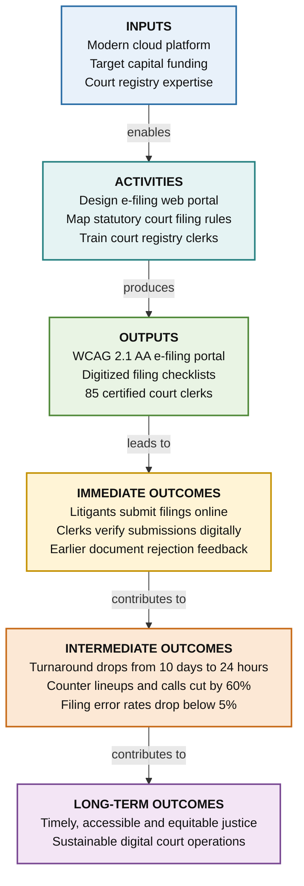

# Worked Example 1: Court Registry Digital E-Filing System

> **Initiative ID**: `WORK-012`  
> **Scope**: Provincial Court Registry Modernization  
> **Methodology Depth**: Extended Logic Model

---

## 1. Context & Scope

- **Need / Problem**: Paper court filings require in-person registry visits, manual entry into legacy mainframes, and cause 10-day processing backlogs for unrepresented litigants.
- **Target Population**: Self-represented litigants, legal counsel, court registry clerks, and trial coordinators.

---

## 2. Results Chain Diagram

---

## 3. Results Chain Details

| Stage | Element | Key Deliverables & Expected Changes |
|---|---|---|
| **Inputs** | Capital funding ($450k), CSB digital team FTEs, modern cloud infrastructure, judicial practice directives |
| **Activities** | Map court filing rules, conduct UX testing with clerks and litigants, build WCAG 2.1 AA web form, deliver training |
| **Outputs** | Modern e-filing web application, digitized filing checklists, 85 court clerks trained, updated public practice notices |
| **Immediate Outcomes** | Self-represented litigants submit online from home; clerks process structured electronic submissions without re-typing |
| **Intermediate Outcomes** | Filing turnaround drops from 10 business days to 24 hours; counter lineups and telephone inquiries decrease by 60% |
| **Long-Term Outcomes** | Equitable, timely access to justice for British Columbians regardless of geographic location or mobility limitations |

---

## 4. Critical Assumptions & Common Mistakes

- **Assumptions**: Legal counsel and the public have reliable internet access; the judiciary accepts digitally authenticated document stamps.
- **Common Mistake Avoided**: Listing "E-filing application built" as an outcome (VAL-03). The software build is an Output; the operational change in filing speed and counter reduction is the Outcome.
