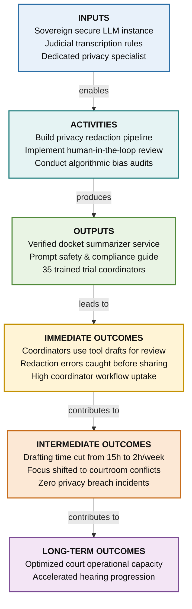

# Worked Example 3: Technology & AI Adoption in Justice Services

> **Status**: Draft (Example Only)  
> **Initiative ID**: `WORK-031` / `IDEA-044`  
> **Scope**: Secure AI Transcript & Docket Summarizer  
> **Methodology Depth**: Extended Logic Model

---

## 1. Context & Scope

- **Need / Problem**: Court administrators and trial coordinators spend up to 15 hours weekly manually compiling hearing notes and transcript extracts across complex multi-week trials.
- **Target Population**: Trial coordinators, court administrative officers, judicial assistants.

---

## 2. Results Chain Diagram

---

## 3. Results Chain Details

| Stage | Element | Key Deliverables & Expected Changes |
|---|---|---|
| **Inputs** | Secure on-premise/sovereign LLM instance, judicial transcription guidelines, dedicated privacy specialist, $150k grant |
| **Activities** | Implement privacy-preserving summarization pipeline, establish human-in-the-loop review workflow, conduct bias audits |
| **Outputs** | Summarization tool integrated with court document repository, prompt safety guide, 35 trial coordinators trained |
| **Immediate Outcomes** | Trial coordinators use tool drafts for docket briefings; privacy/redaction errors are caught prior to sharing |
| **Intermediate Outcomes** | Administrative drafting time per complex docket reduced from 15 hours to 2 hours; coordinators focus on courtroom scheduling conflict resolution |
| **Long-Term Outcomes** | Optimized court operational capacity and accelerated hearing progression without compromising privacy or judicial independence |

---

## 4. Critical Assumptions & Common Mistakes

- **Assumptions**: Transcript transcription quality is high; zero model hallucination leaks into official judicial records.
- **Common Mistake Avoided**: Defining "Deploy sovereign AI model" as the final public value (VAL-11). The AI model is an Input/Enabler; freeing coordinator hours to expedite trials is the public Outcome.
