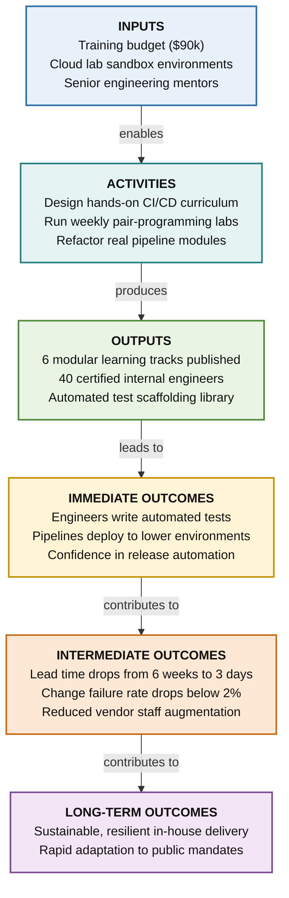

# Worked Example 2: Workforce Training & Capability Development

> **Initiative ID**: `WORK-024`  
> **Scope**: In-House Digital Delivery & Cloud Skills Academy  
> **Methodology Depth**: Extended Logic Model

---

## 1. Context & Scope

- **Need / Problem**: Internal development teams rely on manual testing and monolithic releases, causing frequent release outages and heavy vendor dependency.
- **Target Population**: Internal software engineers, technical leads, QA specialists, and engineering managers.

---

## 2. Results Chain Diagram

---

## 3. Results Chain Details

| Stage | Element | Key Deliverables & Expected Changes |
|---|---|---|
| **Inputs** | Training budget ($90k), learning management platform, cloud lab sandbox environments, 2 senior engineering mentors |
| **Activities** | Design interactive cloud curriculum, conduct weekly pair-programming labs, evaluate real codebase refactoring projects |
| **Outputs** | 6 modular training tracks published, 40 staff software engineers complete hands-on sandbox certification |
| **Immediate Outcomes** | Engineers demonstrate confidence writing automated integration tests and running CI/CD deployment pipelines |
| **Intermediate Outcomes** | Software delivery lead time decreases from 6 weeks to 3 days; change failure rate drops from 22% to under 2% |
| **Long-Term Outcomes** | Sustainable, resilient in-house digital delivery capability that adapts rapidly to changing public service mandates |

---

## 4. Critical Assumptions & Common Mistakes

- **Assumptions**: Managers protect 4 hours/week for staff learning; teams have repository permissions to modernize pipelines.
- **Common Mistake Avoided**: Stating "40 engineers trained" as an outcome (VAL-03). Completion of training is an Output; applying automation to slash deployment lead times is the Outcome.
