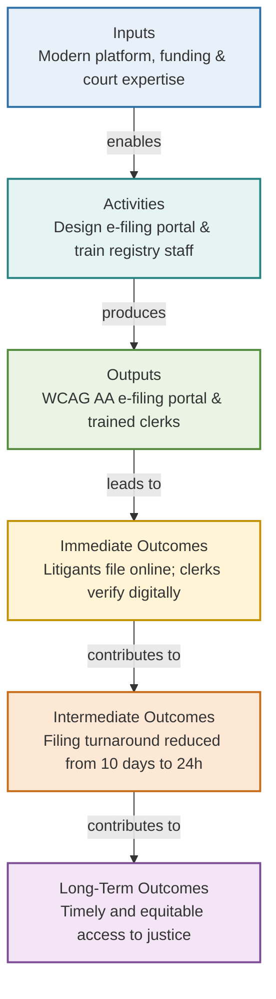

# Worked Examples & Reference Logic Models

## Contents

- [Overview](#overview)
- [Baseline Reference Model (Program Logic Model / Results Chain)](#baseline-reference-model-program-logic-model--results-chain)
- [Program Need-Driven Court Evidence Model](#program-need-driven-court-evidence-model)
- [Worked Example 1: Digital Public-Service Modernization](#worked-example-1-digital-public-service-modernization)
- [Worked Example 2: Workforce Training & Capability Development](#worked-example-2-workforce-training--capability-development)
- [Worked Example 3: Technology & AI Adoption in Justice Services](#worked-example-3-technology--ai-adoption-in-justice-services)

---

## Overview

This guide provides tested, public-sector reference logic models tailored for the B.C. Government and Court Services Branch context, including the canonical program logic model and three worked domains.

---

## Baseline Reference Model (Program Logic Model / Results Chain)

This canonical baseline represents a standard public-sector digital service transformation results chain:

```mermaid
flowchart LR

I["INPUTS<br/>What we invest<br/><br/>Program funding<br/>Staff and expertise<br/>Technology platform<br/>Existing service data"]

A["ACTIVITIES<br/>What we do<br/><br/>Map current services<br/>Redesign processes<br/>Build digital services<br/>Train staff"]

O["OUTPUTS<br/>What we produce<br/><br/>New online services<br/>Redesigned processes<br/>Staff trained<br/>Guidance and tools published"]

IO["IMMEDIATE OUTCOMES<br/>What changes first<br/><br/>Staff gain new capabilities<br/>Services are easier to access<br/>More transactions are digital<br/>Better service data is available"]

MO["INTERMEDIATE OUTCOMES<br/>What changes next<br/><br/>Faster service delivery<br/>Fewer manual processes<br/>Lower administrative effort<br/>Improved client experience<br/>Better evidence-based decisions"]

LO["LONG-TERM OUTCOMES<br/>Ultimate impact<br/><br/>More accessible public services<br/>Better outcomes for citizens<br/>More efficient government<br/>Sustainable digital services"]

I -->|"enables"| A
A -->|"produces"| O
O -->|"leads to"| IO
IO -->|"contributes to"| MO
MO -->|"contributes to"| LO

style I fill:#E8F1FA,stroke:#2B6EA6,stroke-width:2px
style A fill:#E5F3F3,stroke:#258080,stroke-width:2px
style O fill:#E9F4E4,stroke:#518A3A,stroke-width:2px
style IO fill:#FFF4D6,stroke:#C49102,stroke-width:2px
style MO fill:#FCE8D5,stroke:#C76B19,stroke-width:2px
style LO fill:#F3E5F5,stroke:#7B4B94,stroke-width:2px
```

---

## Program Need-Driven Court Evidence Model

This model demonstrates the top-to-bottom (`flowchart TB`) architecture with an explicit **Program Need** anchor (`N -->|"justifies"| I`) and reusable `classDef` CSS classes. It captures court validation rules, digital exhibit management, and verified credential access:

```mermaid
flowchart TB

N["PROGRAM NEED<br/>Court processes remain manual,<br/>high-touch and fragmented.<br/>Validation often occurs late.<br/>Digital evidence is hard to manage.<br/>Policy changes require manual effort."]

I["INPUTS<br/>Program funding<br/>Court policy and expertise<br/>CSO and CEIS services<br/>BC Court Assistant<br/>CITZ shared IDP capability<br/>Azure and OpenShift platforms<br/>Verified credentials<br/>Security and privacy controls"]

A["ACTIVITIES<br/>Encode policy rules<br/>Build pre-flight validation<br/>Configure data extraction<br/>Set confidence thresholds<br/>Integrate results with CEIS<br/>Enable self-service authoring<br/>Digitize exhibit management<br/>Expose governed APIs<br/>Implement credential access"]

O["OUTPUTS<br/>Validation portal and API<br/>Machine-readable rule schemas<br/>Validation tokens<br/>Extracted fields and scores<br/>Human-review routing<br/>Form-authoring tools<br/>Digital-exhibit service<br/>External filing APIs<br/>Credential-based access"]

IO["IMMEDIATE OUTCOMES<br/>Earlier client feedback<br/>Problems detected sooner<br/>Structured registry data<br/>Faster rule updates<br/>Secure digital access<br/>Less removable-media handling<br/>More traceable decisions"]

MO["INTERMEDIATE OUTCOMES<br/>Fewer rejected filings<br/>Better first-time accuracy<br/>Less manual processing<br/>Faster service delivery<br/>More consistent enforcement<br/>Lower vendor dependence<br/>Fewer counter visits<br/>Safer information handling"]

LO["LONG-TERM OUTCOMES<br/>More accessible court services<br/>More timely court services<br/>Reliable court administration<br/>Sustainable digital delivery<br/>Protected judicial information<br/>Improved access to justice<br/>Fully digital court processes"]

N -->|"justifies"| I
I -->|"enables"| A
A -->|"produces"| O
O -->|"leads to"| IO
IO -->|"contributes to"| MO
MO -->|"contributes to"| LO

classDef need fill:#F4F4F4,stroke:#555,color:#111
classDef input fill:#E8F1FA,stroke:#2B6EA6,color:#111
classDef activity fill:#E5F3F3,stroke:#258080,color:#111
classDef output fill:#E9F4E4,stroke:#518A3A,color:#111
classDef immediate fill:#FFF4D6,stroke:#C49102,color:#111
classDef intermediate fill:#FCE8D5,stroke:#C76B19,color:#111
classDef longterm fill:#F3E5F5,stroke:#7B4B94,color:#111

class N need
class I input
class A activity
class O output
class IO immediate
class MO intermediate
class LO longterm
```

---

## Worked Example 1: Digital Public-Service Modernization

### Context & Scope
- **Initiative**: CSB Court Registry Digital E-Filing System (`WORK-012`).
- **Need / Problem**: Paper filings require in-person registry visits, manual entry into legacy mainframes, and cause 10-day processing backlogs for unrepresented litigants.

### Logic Model Table

| Stage | Element | Details |
|---|---|---|
| **Inputs** | Capital funding ($450k), CSB digital team FTEs, modern cloud infrastructure, judicial practice directives |
| **Activities** | Map court filing rules, conduct UX testing with registry clerks and self-represented litigants, build WCAG 2.1 AA web form, deliver clerk training |
| **Outputs** | Modern e-filing web application, digitized filing checklists, 85 court clerks trained, updated public practice notices |
| **Immediate Outcomes** | Self-represented litigants successfully submit filings online from home; clerks process structured electronic submissions without re-typing |
| **Intermediate Outcomes** | Filing processing turnaround drops from 10 business days to 24 hours; counter lineups and telephone inquiries decrease by 60% |
| **Long-Term Outcomes** | Equitable, timely access to justice for British Columbians regardless of geographic location or mobility limitations |

### Critical Assumptions & External Factors
- **Assumptions**: Legal counsel and public have reliable internet access; judiciary accepts digitally authenticated document stamps.
- **External Factors**: Judicial independence directives; statutory FOIPPA privacy requirements; union engagement regarding automated workflows.

### Sample Measurement Indicators
- **Output**: 1 web application deployed; 85 registry clerks certified.
- **Immediate Outcome**: 45% of total monthly filings received through e-filing in Month 3.
- **Intermediate Outcome**: Average filing review turnaround under 24 hours; rejection rate due to incomplete forms drops below 5%.
- **Long-Term Outcome**: Annual public satisfaction survey rating for registry access exceeding 80%.

### Common Modelling Mistakes to Avoid
- *Mistake*: Listing "E-filing application built" as the outcome (VAL-03: output mistaken for outcome).
- *Mistake*: Claiming the project alone "eliminated judicial case backlogs" (VAL-05: over-claimed attribution).

### Mermaid Diagram

---

## Worked Example 2: Workforce Training & Capability Development

### Context & Scope
- **Initiative**: Continuous Delivery & Cloud Skills Academy (`WORK-024`).
- **Need / Problem**: Internal development teams rely on manual testing and monolithic releases, causing frequent release outages and vendor lock-in.

### Logic Model Table

| Stage | Element | Details |
|---|---|---|
| **Inputs** | Training budget ($90k), learning management platform, cloud lab sandbox environments, 2 senior engineering mentors |
| **Activities** | Design interactive cloud curriculum, conduct weekly pair-programming labs, evaluate real codebase refactoring projects |
| **Outputs** | 6 modular training tracks published, 40 staff software engineers complete hands-on sandbox certification |
| **Immediate Outcomes** | Engineers demonstrate confidence writing automated integration tests and running CI/CD deployment pipelines |
| **Intermediate Outcomes** | Software delivery lead time decreases from 6 weeks to 3 days; change failure rate drops from 22% to under 2% |
| **Long-Term Outcomes** | Sustainable, resilient in-house digital delivery capability that adapts rapidly to changing public service mandates |

### Critical Assumptions & External Factors
- **Assumptions**: Managers protect 4 hours/week for staff learning; teams have repository permissions to modernize pipelines.
- **External Factors**: Staff attrition to private sector; enterprise cybersecurity approval delays for modern pipeline tooling.

### Sample Measurement Indicators
- **Output**: 40 engineers completed lab modules.
- **Immediate Outcome**: 90% pass rate on sandbox pipeline assessment; 100% of participants self-report increased capability.
- **Intermediate Outcome**: DORA metric deployment frequency increases from monthly to daily; MTTR under 1 hour.
- **Long-Term Outcome**: Reduction in outsourced vendor augmentation expenditure by $350k annually.

### Common Modelling Mistakes to Avoid
- *Mistake*: Stating "40 engineers trained" as an outcome (VAL-03). The outcome is the *application* of testing and automated deployment in active codebases.
- *Mistake*: Assuming training alone guarantees pipeline improvements if organizational branch policies block automated deployment (VAL-14).

---

## Worked Example 3: Technology & AI Adoption in Justice Services

### Context & Scope
- **Initiative**: Secure AI Transcript & Docket Summarizer (`IDEA-044` / `WORK-031`).
- **Need / Problem**: Court administrators and trial coordinators spend up to 15 hours weekly manually compiling hearing notes and transcript extracts across complex multi-week trials.

### Logic Model Table

| Stage | Element | Details |
|---|---|---|
| **Inputs** | Secure on-premise/sovereign LLM instance, judicial transcription guidelines, dedicated privacy specialist, $150k grant |
| **Activities** | Implement privacy-preserving summarization pipeline, establish human-in-the-loop review workflow, conduct bias audits |
| **Outputs** | Summarization tool integrated with court document repository, prompt safety guide, 35 trial coordinators trained |
| **Immediate Outcomes** | Trial coordinators use tool drafts for docket briefings; privacy/redaction errors are caught prior to sharing |
| **Intermediate Outcomes** | Administrative drafting time per complex docket reduced from 15 hours to 2 hours; coordinators focus on courtroom scheduling conflict resolution |
| **Long-Term Outcomes** | Optimized court operational capacity and accelerated hearing progression without compromising privacy or judicial independence |

### Critical Assumptions & External Factors
- **Assumptions**: Transcript transcription quality is high; zero model hallucination leaks into official judicial records.
- **External Factors**: Judicial council governance policy on generative AI; public transparency and FOIPPA compliance requirements.

### Sample Measurement Indicators
- **Output**: 1 verified summarizer service deployed; 0 privacy incidents recorded.
- **Immediate Outcome**: 85% of coordinators actively utilize AI summaries as preliminary drafting aids.
- **Intermediate Outcome**: 13 hours saved per coordinator per week; 98% accuracy verified by human reviewer.
- **Long-Term Outcome**: Hearing scheduling backlog reduced by 15% across pilot trial courts.

### Common Modelling Mistakes to Avoid
- *Mistake*: Defining "Deploy sovereign AI model" as the long-term impact (VAL-11: technology implementation as final value).
- *Mistake*: Overlooking the mandatory human-in-the-loop validation gate when moving from tool output to judicial decisions (VAL-14).
