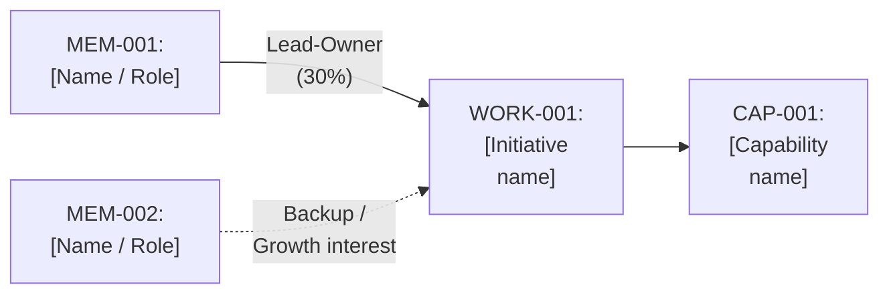
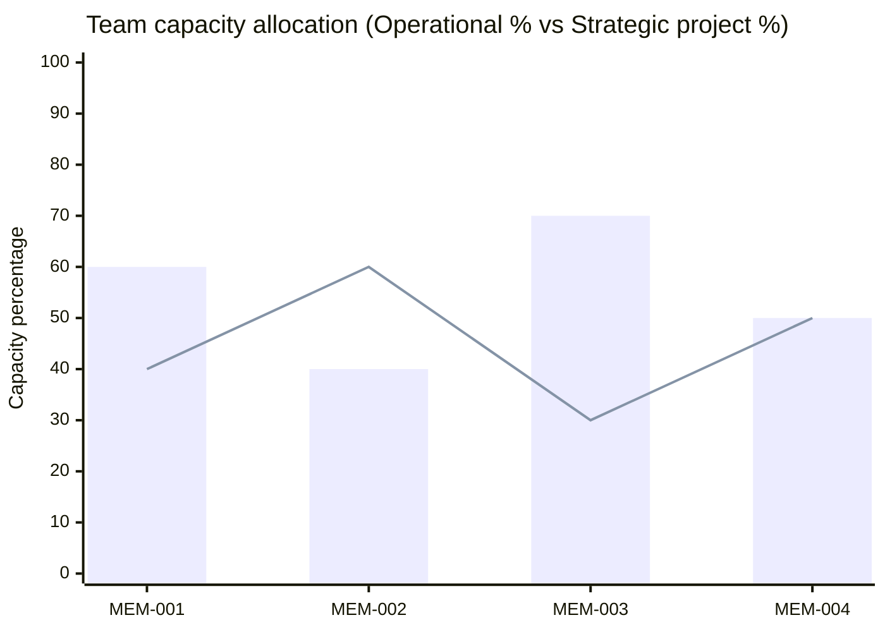

# Team skills, growth interests and work allocation register

**Branch / Team:** [Name]  
**Portfolio link:** `strategy/05-business-capabilities.md` (`CAP-X`) and `strategy/08-work-inventory.md` (`WORK-X`)  

## 1. Team member skills, capabilities and growth interests

| Member ID | Name / Role | Core skills and domain strengths | Linked capabilities (`CAP-X` + Proficiency `L1`–`L3`) | Growth and learning interests (`CAP-X` or topic) | Baseline operational load (`%`) | Strategic / project capacity (`%`) |
|---|---|---|---|---|---|---|
| MEM-001 | | | | | 60% | 40% |
| MEM-002 | | | | | 40% | 60% |

## 2. Active work assignment tracker (`MEM-X` to `WORK-X`)

| Assignment ID | Member (`MEM-X`) | Assigned work item (`WORK-X`) | Work type (`Initiative` / `Project` / `Experiment` / `Operational`) | Assignment role (`Lead-Owner` / `Contributor` / `Backup-Reviewer`) | Linked capability (`CAP-X`) | Estimated allocation (`%`) | Status (`Active` / `Planned` / `Blocked`) |
|---|---|---|---|---|---|---|---|
| ASG-001 | MEM-001 | WORK-001 | Initiative | Lead-Owner | CAP-001 | 30% | Active |
| ASG-002 | MEM-002 | WORK-001 | Initiative | Backup-Reviewer | CAP-001 | 10% | Active |

## 3. Capacity, coverage and key-person risk diagnostics

| Diagnostic check | Finding (`MEM-X` / `CAP-X` / `WORK-X`) | Recommended coaching or rebalancing action |
|---|---|---|
| **Single-point-of-failure ("bus factor = 1")** | [Capability or Work ID with only 1 SME/Lead and no backup] | [Pair with a colleague who has a matching growth interest] |
| **Over-allocated bottlenecks (>100% total or >3 active leads)** | [Member IDs] | [Sequence into Horizon 2 or reassign contributor support] |
| **Growth interest matched to capability gap** | [Member ID + Capability ID] | [Assign as co-lead or exploratory lead on upcoming work] |
| **Unassigned committed work (`WORK-X` with no owner)** | [Work IDs] | [Assign owner or pause work item] |

## 4. Visual workload and assignment maps (Mermaid)

### 4.1 Team member to committed work and capability map

### 4.2 Team capacity split (Operational baseline % vs. Strategic project %)

