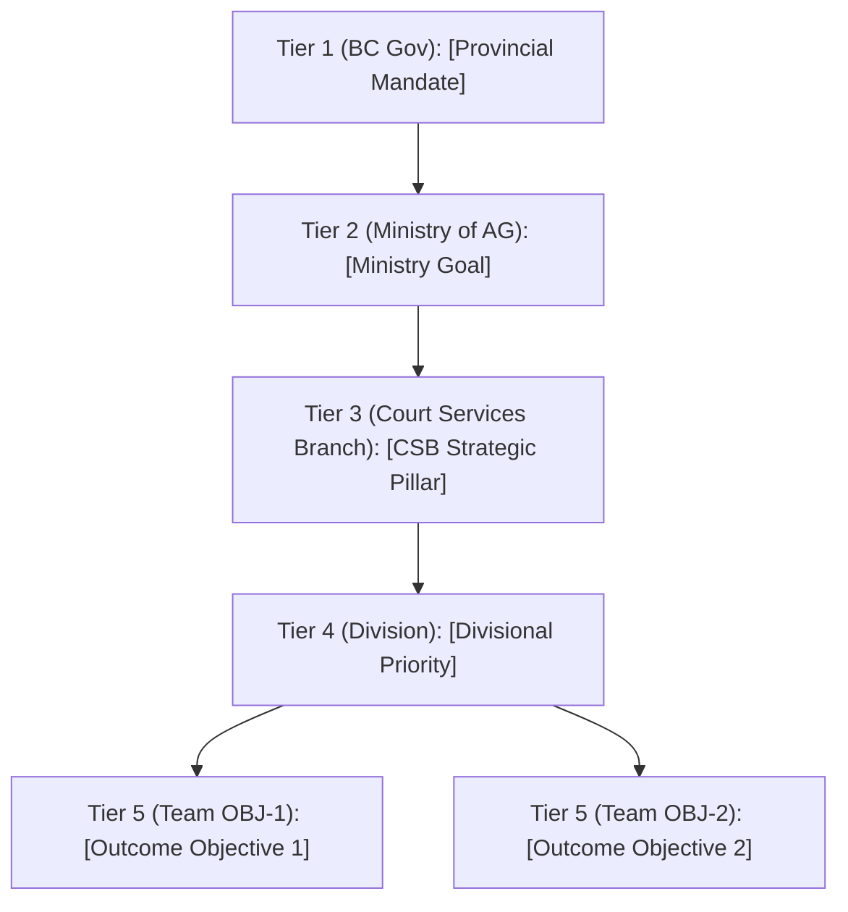
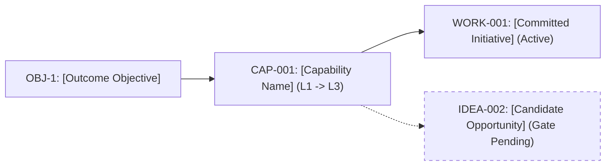
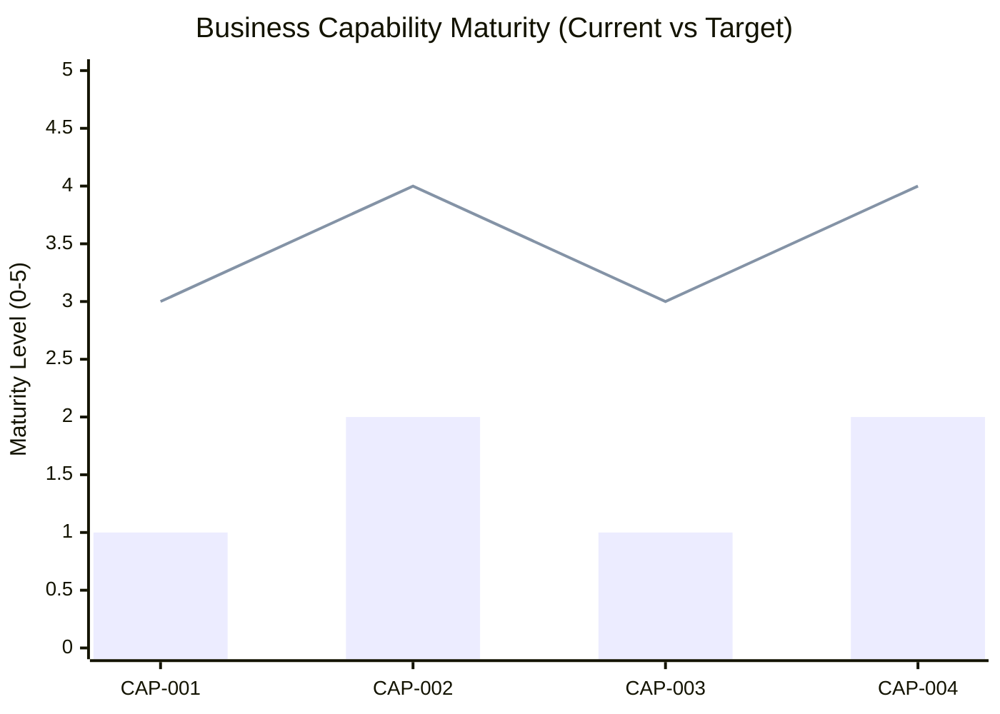
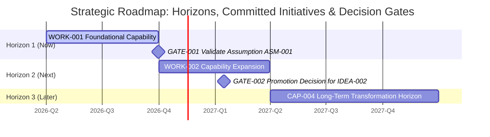

# Visual Strategy Package (Mermaid Diagrams & Roadmaps)

**Branch / Team:** [Name]  

## 1. Five-Tier Organizational Line-of-Sight (`Province -> Ministry -> CSB -> Division -> Team`)

## 2. End-to-End Strategy, Capability & Portfolio Alignment Map

## 3. Capability Maturity Gap Chart (`Current vs. Target`)

## 4. High-Level Strategic Roadmap & Decision Gate Gantt Chart

> **Note:** Solid bars represent **Committed Work (`WORK-X`)**. Milestones (`◆`) represent **Validation & Promotion Decision Gates (`GATE-X` / `IDEA-X`)**.

